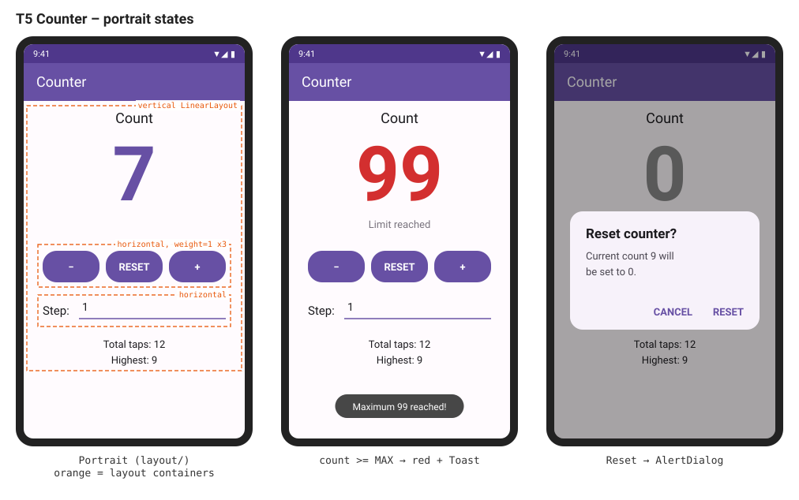

# EE5415 Android Programming Test – Cheat Sheets

My personal quick-reference sheets for the EE5415 Week 13 programming test (3 hrs, Lab PC, B7701).
Built from the course lecture slides (L01–L09, Storage, RecyclerView). **Java first, Kotlin second.**

> Exam rules reminder: browse in a web browser only. No cloning or downloading. No AI tools. Type everything yourself.

## 🗺️ Index

| # | Sheet | Use it when… |
|---|-------|--------------|
| 00 | [Exam-day checklist & 3-hr plan](sheets/00-exam-day-checklist.md) | Before you start / when stuck |
| 01 | [Project setup, Gradle, Manifest](sheets/01-project-setup-gradle-manifest.md) | Adding dependencies, permissions, activities |
| 02 | [XML layouts & widgets](sheets/02-layouts-widgets.md) | Building any screen |
| 03 | [Activity, Intent, Dialogs, Menu, Lifecycle](sheets/03-activity-intent-lifecycle.md) | Multi-screen apps, passing data |
| 04 | [Fragments](sheets/04-fragments.md) | Static/dynamic fragments, list-detail |
| 05 | [MVP / MVVM / MVI + LiveData](sheets/05-architecture-mvvm.md) | "Use ViewModel/LiveData" requirements |
| 06 | [Threads, Handler, Executor, Coroutines](sheets/06-threads-concurrency.md) | Background work, progress bar |
| 07 | [Networking + JSON](sheets/07-networking-json.md) | HTTP GET, parse JSON |
| 08 | [Storage: SharedPreferences, Files, Room](sheets/08-storage-prefs-files-room.md) | Save/load data |
| 09 | [RecyclerView (basic, click, ListAdapter, multi-type, grid)](sheets/09-recyclerview.md) | Any list |
| 10 | [ViewBinding & DataBinding](sheets/10-viewbinding-databinding.md) | Replace findViewById |
| 11 | [Graphics & Animation](sheets/11-graphics-animation.md) | Shapes, Canvas, animate() |
| 12 | [Kotlin quick syntax](sheets/12-kotlin-syntax.md) | If writing Kotlin |
| 13 | [Common errors & fixes](sheets/13-errors-troubleshooting.md) | Crashes, Gradle errors |
| 14 | [🖼️ **Screen gallery + layout change recipes**](sheets/14-screen-gallery.md) | **See what a layout looks like / rearrange a screen** |

## 🧩 Full app templates (copy-by-typing)

| Template | Covers |
|----------|--------|
| [T1 BMI app (2 activities + prefs + validation)](templates/T1-bmi-two-activities.md) | Form → result screen |
| [T2 Notes/List app (Room + RecyclerView + add/delete)](templates/T2-room-recyclerview-crud.md) | CRUD list with database |
| [T3 Tic Tac Toe (grid of buttons + game logic)](templates/T3-tictactoe.md) | Game with a board |
| [T4 Timer/Counter with Handler + ProgressBar](templates/T4-progress-handler.md) | Background thread → UI update |
| [**T5 Counter app** (+/−/reset, step, limit, saved count, landscape, multi-counter list)](templates/T5-counter-app.md) | **Counting app + layout variations** |

## Quick lookup
| Requirement | Go to |
|---|---|
| Count clicks / score / +/− buttons | T5 |
| Change or rearrange the layout | 14 (pictures + recipes) |
| Landscape layout | T5 landscape, 14 recipes |
| Remember value after closing app | 08 SharedPreferences, T5 |
| List of items | 09, T2, T5-D |

## 🔗 Official docs (allowed: API reference)
- API reference: https://developer.android.com/reference
- Activities: https://developer.android.com/guide/components/activities/intro-activities
- RecyclerView: https://developer.android.com/develop/ui/views/layout/recyclerview
- Room: https://developer.android.com/training/data-storage/room
- ConstraintLayout: https://developer.android.com/develop/ui/views/layout/constraint-layout
- Data storage: https://developer.android.com/training/data-storage
