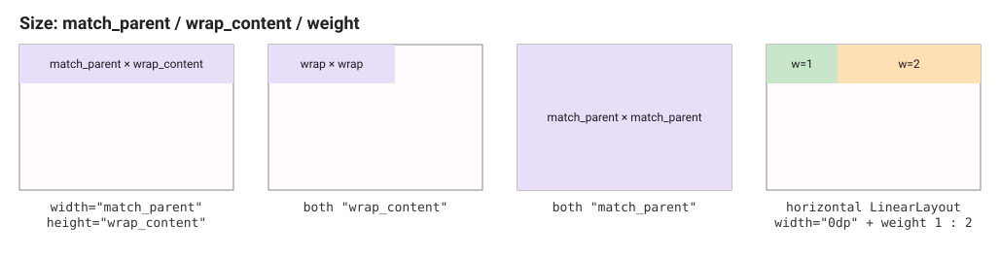
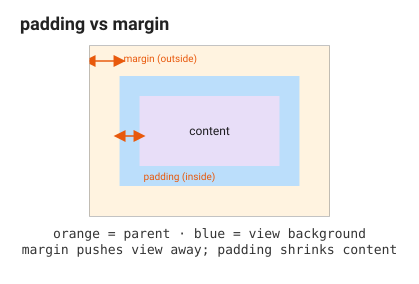
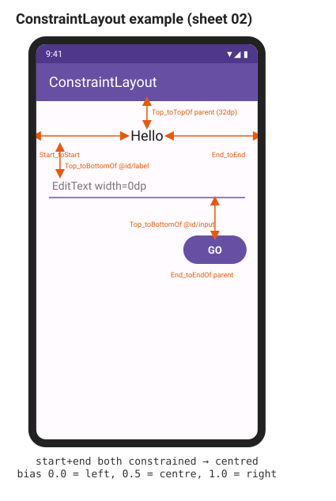
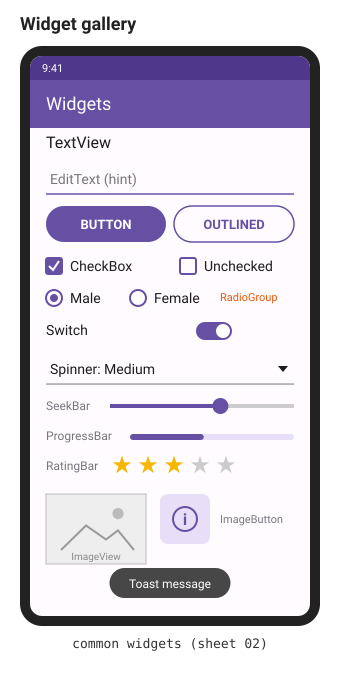

# 02 · XML Layouts & Widgets

[⬅ Index](../README.md) · More pictures and layout change recipes: [sheet 14](14-screen-gallery.md)

## Size rules


| Value | Meaning |
|---|---|
| `match_parent` | fill parent |
| `wrap_content` | as big as content |
| `0dp` | in ConstraintLayout = *match constraints*. In LinearLayout, use it with `layout_weight` |
| `padding` | inside border · `margin` = outside border |




## LinearLayout (fastest to write)


```xml
<?xml version="1.0" encoding="utf-8"?>
<LinearLayout xmlns:android="http://schemas.android.com/apk/res/android"
    xmlns:tools="http://schemas.android.com/tools"
    android:layout_width="match_parent"
    android:layout_height="match_parent"
    android:orientation="vertical"
    android:padding="16dp"
    tools:context=".MainActivity">

    <TextView
        android:id="@+id/titleTV"
        android:layout_width="wrap_content"
        android:layout_height="wrap_content"
        android:layout_gravity="center_horizontal"
        android:text="My App"
        android:textSize="24sp"
        android:textStyle="bold" />

    <EditText
        android:id="@+id/heightET"
        android:layout_width="match_parent"
        android:layout_height="wrap_content"
        android:hint="Height (cm)"
        android:inputType="numberDecimal" />

    <!-- Two buttons side by side, equal width -->
    <LinearLayout
        android:layout_width="match_parent"
        android:layout_height="wrap_content"
        android:orientation="horizontal">
        <Button
            android:id="@+id/okBtn"
            android:layout_width="0dp"
            android:layout_height="wrap_content"
            android:layout_weight="1"
            android:text="OK" />
        <Button
            android:id="@+id/clearBtn"
            android:layout_width="0dp"
            android:layout_height="wrap_content"
            android:layout_weight="1"
            android:layout_marginStart="8dp"
            android:text="Clear" />
    </LinearLayout>
</LinearLayout>
```
Long form? Wrap the content in a `<ScrollView>`, which takes exactly **one** child.

## ConstraintLayout


```xml
<androidx.constraintlayout.widget.ConstraintLayout
    xmlns:android="http://schemas.android.com/apk/res/android"
    xmlns:app="http://schemas.android.com/apk/res-auto"
    android:layout_width="match_parent"
    android:layout_height="match_parent">

    <TextView
        android:id="@+id/label"
        android:layout_width="wrap_content"
        android:layout_height="wrap_content"
        android:text="Hello"
        android:layout_marginTop="32dp"
        app:layout_constraintTop_toTopOf="parent"
        app:layout_constraintStart_toStartOf="parent"
        app:layout_constraintEnd_toEndOf="parent" />

    <EditText
        android:id="@+id/input"
        android:layout_width="0dp"
        android:layout_height="wrap_content"
        android:layout_margin="16dp"
        app:layout_constraintTop_toBottomOf="@id/label"
        app:layout_constraintStart_toStartOf="parent"
        app:layout_constraintEnd_toEndOf="parent" />

    <Button
        android:id="@+id/btn"
        android:layout_width="wrap_content"
        android:layout_height="wrap_content"
        android:layout_marginEnd="16dp"
        android:text="Go"
        app:layout_constraintTop_toBottomOf="@id/input"
        app:layout_constraintEnd_toEndOf="parent" />
</androidx.constraintlayout.widget.ConstraintLayout>
```
The pattern is `layout_constraint<Source>_to<Target>Of`. Every view needs ≥1 horizontal **and** ≥1 vertical constraint, or it jumps to the top-left at runtime.

## TableLayout
```xml
<TableLayout android:layout_width="match_parent" android:layout_height="wrap_content"
    android:stretchColumns="1">
    <TableRow>
        <TextView android:text="Height:" />
        <EditText android:id="@+id/h" android:inputType="numberDecimal" />
    </TableRow>
    <TableRow>
        <TextView android:text="Weight:" />
        <EditText android:id="@+id/w" android:inputType="numberDecimal" />
    </TableRow>
</TableLayout>
```

## GridLayout (3×3 board)
```xml
<GridLayout
    android:id="@+id/board"
    android:layout_width="wrap_content"
    android:layout_height="wrap_content"
    android:columnCount="3"
    android:rowCount="3">
    <Button android:id="@+id/b0" android:layout_width="80dp" android:layout_height="80dp" android:textSize="32sp"/>
    <!-- ... b1..b8 -->
</GridLayout>
```

## Widgets cheat-table (XML + Java)


### EditText
```xml
<EditText android:id="@+id/nameET" android:inputType="text|textCapWords" android:hint="Name"/>
<!-- inputType: number, numberDecimal, numberSigned, textPassword, textEmailAddress, phone -->
```
```java
String s = nameET.getText().toString().trim();
if (s.isEmpty()) { nameET.setError("Required"); return; }
double h = Double.parseDouble(s);   // wrap in try/catch NumberFormatException
```

### Button + click
```java
Button btn = findViewById(R.id.okBtn);
btn.setOnClickListener(v -> doSomething());
btn.setOnLongClickListener(v -> { doOther(); return true; });
```
XML alternative: `android:onClick="onOkClick"` + `public void onOkClick(View v) {}`.

### CheckBox
```xml
<CheckBox android:id="@+id/agreeCB" android:text="I agree"/>
```
```java
boolean checked = agreeCB.isChecked();
agreeCB.setOnCheckedChangeListener((b, isChecked) -> { /* ... */ });
```

### RadioGroup / RadioButton
```xml
<RadioGroup android:id="@+id/genderRG" android:orientation="horizontal">
    <RadioButton android:id="@+id/maleRB" android:text="Male" android:checked="true"/>
    <RadioButton android:id="@+id/femaleRB" android:text="Female"/>
</RadioGroup>
```
```java
int id = genderRG.getCheckedRadioButtonId();   // -1 if none
if (id == R.id.maleRB) { ... }
genderRG.setOnCheckedChangeListener((group, checkedId) -> { ... });
```

### Switch / ToggleButton
```xml
<Switch android:id="@+id/darkSW" android:text="Dark mode"/>
<ToggleButton android:id="@+id/tb" android:textOn="ON" android:textOff="OFF"/>
```
```java
darkSW.setOnCheckedChangeListener((b, on) -> { ... });
```

### RatingBar
```xml
<RatingBar android:id="@+id/rb" android:numStars="5" android:stepSize="0.5"
    android:layout_width="wrap_content" android:layout_height="wrap_content"/>
```
```java
rb.setOnRatingBarChangeListener((bar, rating, fromUser) ->
    Toast.makeText(this, "Rating: " + rating, Toast.LENGTH_SHORT).show());
```

### SeekBar
```java
seek.setOnSeekBarChangeListener(new SeekBar.OnSeekBarChangeListener() {
    public void onProgressChanged(SeekBar s, int p, boolean fromUser) { valueTV.setText("" + p); }
    public void onStartTrackingTouch(SeekBar s) {}
    public void onStopTrackingTouch(SeekBar s) {}
});
```

### Spinner (dropdown)
```xml
<Spinner android:id="@+id/levelSP" android:entries="@array/levels"
    android:layout_width="match_parent" android:layout_height="wrap_content"/>
```
```java
String level = levelSP.getSelectedItem().toString();
// or programmatic:
ArrayAdapter<String> ad = new ArrayAdapter<>(this,
        android.R.layout.simple_spinner_item, new String[]{"A","B","C"});
ad.setDropDownViewResource(android.R.layout.simple_spinner_dropdown_item);
levelSP.setAdapter(ad);
levelSP.setOnItemSelectedListener(new AdapterView.OnItemSelectedListener() {
    public void onItemSelected(AdapterView<?> p, View v, int pos, long id) { }
    public void onNothingSelected(AdapterView<?> p) { }
});
```

### ImageView / ImageButton
```xml
<ImageView android:id="@+id/img" android:src="@drawable/bot_fit"
    android:layout_width="120dp" android:layout_height="120dp" android:scaleType="fitCenter"
    android:contentDescription="result image"/>
<ImageButton android:id="@+id/aboutIB" android:src="@android:drawable/ic_dialog_info"/>
```
```java
img.setImageResource(R.drawable.bot_fat);
```

### ProgressBar
```xml
<ProgressBar android:id="@+id/pb" style="?android:attr/progressBarStyleHorizontal"
    android:layout_width="match_parent" android:layout_height="wrap_content" android:max="100"/>
```
```java
pb.setProgress(50);  pb.setVisibility(View.GONE);
```

### TextView
```java
tv.setText("BMI: " + String.format(Locale.US, "%.2f", bmi));
tv.setTextColor(Color.RED);
tv.setVisibility(View.VISIBLE);   // VISIBLE / INVISIBLE (keeps space) / GONE
```

### Toast
```java
Toast.makeText(this, "Saved!", Toast.LENGTH_SHORT).show();
```

## Landscape layout
1. Right-click `res` → **New → Android Resource Directory** → name `layout-land`. Copy `activity_main.xml` into it (same file name).
2. Or open the layout → Design view → orientation icon → **Create Landscape Qualifier**.
3. **Keep the same view IDs** in both files.

Example picture: [T5 landscape](../templates/T5-counter-app.md)

## Shape background (rounded button / card)
`res/drawable/rounded_bg.xml`
```xml
<shape xmlns:android="http://schemas.android.com/apk/res/android" android:shape="rectangle">
    <solid android:color="#E3F2FD"/>
    <corners android:radius="12dp"/>
    <stroke android:width="2dp" android:color="#1565C0"/>
</shape>
```
`android:background="@drawable/rounded_bg"`. With Material theme Buttons, use `app:backgroundTint` instead, or use `androidx.appcompat.widget.AppCompatButton`.
