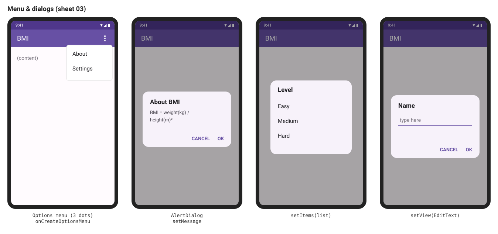

# 03 · Activity, Intent, Lifecycle, Dialogs, Menu

[⬅ Index](../README.md)

## Lifecycle cheat
```
onCreate → onStart → onResume → [RUNNING] → onPause → onStop → onDestroy
                                      ↑ onRestart ←───────┘
```
| Scenario | Calls |
|---|---|
| First launch | onCreate → onStart → onResume |
| Open another Activity, then Back | onPause → onStop → *(back)* onRestart → onStart → onResume |
| **Rotate screen** | onPause → onStop → onDestroy → onCreate → onStart → onResume ⚠️ data lost |
| Home button | onPause → onStop |

- `onCreate`: setContentView, findViewById, listeners (one-time setup)
- `onStart`/`onResume`: refresh UI
- `onPause`/`onStop`: save data, release resources
- Log them: `Log.d("LIFE", "onStart");`

## Basic Activity (Java)
```java
public class MainActivity extends AppCompatActivity {
    private EditText heightET, weightET;
    private Button reportBtn;

    @Override
    protected void onCreate(Bundle savedInstanceState) {
        super.onCreate(savedInstanceState);
        setContentView(R.layout.activity_main);

        heightET = findViewById(R.id.heightET);
        weightET = findViewById(R.id.weightET);
        reportBtn = findViewById(R.id.reportBtn);

        reportBtn.setOnClickListener(v -> openReport());
    }
}
```
> New templates may add `EdgeToEdge.enable(this)` and `ViewCompat.setOnApplyWindowInsetsListener(findViewById(R.id.main), ...)`. If you remove `android:id="@+id/main"` from the root layout, also delete that block, or the app **crashes with NullPointerException**.

## Explicit Intent + extras (pass data)
```java
// Sender
Intent i = new Intent(MainActivity.this, ReportActivity.class);
i.putExtra("HEIGHT", 170.0);
i.putExtra("NAME", "Daniel");
startActivity(i);

// Receiver (ReportActivity.onCreate)
Intent intent = getIntent();
double h = intent.getDoubleExtra("HEIGHT", 0.0);
String name = intent.getStringExtra("NAME");
```
Bundle alternative:
```java
Bundle b = new Bundle(); b.putString("NAME", "x"); i.putExtras(b);
Bundle got = getIntent().getExtras(); if (got != null) { got.getString("NAME"); }
```
Close the current screen and return: `finish();`

## Get a result back (ActivityResultLauncher)
```java
// In MainActivity (field)
private final ActivityResultLauncher<Intent> launcher =
    registerForActivityResult(new ActivityResultContracts.StartActivityForResult(), result -> {
        if (result.getResultCode() == RESULT_OK && result.getData() != null) {
            String reply = result.getData().getStringExtra("REPLY");
            replyTV.setText(reply);
        }
    });

// launch
launcher.launch(new Intent(this, SecondActivity.class));

// In SecondActivity
Intent data = new Intent();
data.putExtra("REPLY", "hello back");
setResult(RESULT_OK, data);
finish();
```
Old way (deprecated, still works):
```java
startActivityForResult(intent, 1);
@Override protected void onActivityResult(int req, int res, Intent data) {
    super.onActivityResult(req, res, data);
    if (req == 1 && res == RESULT_OK) { ... }
}
```

## Implicit intents
```java
// Web page
startActivity(new Intent(Intent.ACTION_VIEW, Uri.parse("https://www.cityu.edu.hk")));
// Dial
startActivity(new Intent(Intent.ACTION_DIAL, Uri.parse("tel:12345678")));
// Map
startActivity(new Intent(Intent.ACTION_VIEW, Uri.parse("geo:22.3364,114.1720?q=CityU")));
// Share text
Intent s = new Intent(Intent.ACTION_SEND);
s.setType("text/plain");
s.putExtra(Intent.EXTRA_TEXT, "My BMI is 22");
startActivity(Intent.createChooser(s, "Share via"));
// Email
Intent e = new Intent(Intent.ACTION_SENDTO, Uri.parse("mailto:someone@cityu.edu.hk"));
e.putExtra(Intent.EXTRA_SUBJECT, "Hi");
startActivity(e);
```

## Save state on rotation
```java
@Override
protected void onSaveInstanceState(@NonNull Bundle outState) {
    super.onSaveInstanceState(outState);
    outState.putInt("SCORE", score);
    outState.putString("RESULT", resultTV.getText().toString());
}

// in onCreate after findViewById
if (savedInstanceState != null) {
    score = savedInstanceState.getInt("SCORE", 0);
    resultTV.setText(savedInstanceState.getString("RESULT", ""));
}
```
(Or use a ViewModel. See sheet 05.) An `EditText` with an `id` restores its own text automatically.

## AlertDialog (About / Confirm)


```java
new AlertDialog.Builder(this)          // androidx.appcompat.app.AlertDialog
    .setTitle("About BMI")
    .setMessage("BMI = weight(kg) / height(m)^2")
    .setPositiveButton("OK", (d, which) -> d.dismiss())
    .setNegativeButton("Cancel", null)
    .show();
```
List-choice dialog:
```java
String[] items = {"Easy","Medium","Hard"};
new AlertDialog.Builder(this).setTitle("Level")
    .setItems(items, (d, which) -> levelTV.setText(items[which])).show();
```
Input dialog:
```java
EditText input = new EditText(this);
new AlertDialog.Builder(this).setTitle("Name").setView(input)
    .setPositiveButton("OK", (d, w) -> nameTV.setText(input.getText().toString()))
    .show();
```

## Options menu (top-right ⋮)
`res/menu/main_menu.xml`
```xml
<menu xmlns:android="http://schemas.android.com/apk/res/android"
      xmlns:app="http://schemas.android.com/apk/res-auto">
    <item android:id="@+id/action_about" android:title="About" app:showAsAction="never"/>
    <item android:id="@+id/action_settings" android:title="Settings"/>
</menu>
```
```java
@Override
public boolean onCreateOptionsMenu(Menu menu) {
    getMenuInflater().inflate(R.menu.main_menu, menu);
    return true;
}
@Override
public boolean onOptionsItemSelected(@NonNull MenuItem item) {
    int id = item.getItemId();
    if (id == R.id.action_about) { showAbout(); return true; }
    if (id == R.id.action_settings) { startActivity(new Intent(this, SettingsActivity.class)); return true; }
    return super.onOptionsItemSelected(item);
}
```
> The menu needs an ActionBar. Make sure the theme is not `NoActionBar`, or add a `Toolbar` + `setSupportActionBar(toolbar)`.

Back arrow on the second activity: `getSupportActionBar().setDisplayHomeAsUpEnabled(true);` + `android:parentActivityName` in the manifest.

## Back stack notes
- `startActivity` pushes. **Back** / `finish()` pops.
- Clear stack (e.g. after logout): `i.setFlags(Intent.FLAG_ACTIVITY_NEW_TASK | Intent.FLAG_ACTIVITY_CLEAR_TASK);`

## BroadcastReceiver (Kotlin)
```kotlin
// send
sendBroadcast(Intent("com.example.ACTION_PLAY_MUSIC"))
// receive
private val receiver = object : BroadcastReceiver() {
    override fun onReceive(context: Context, intent: Intent) { /* ... */ }
}
// Android 13+ requires an exported flag:
ContextCompat.registerReceiver(this, receiver,
    IntentFilter("com.example.ACTION_PLAY_MUSIC"), ContextCompat.RECEIVER_NOT_EXPORTED)
// unregisterReceiver(receiver) in onDestroy/onStop
```
