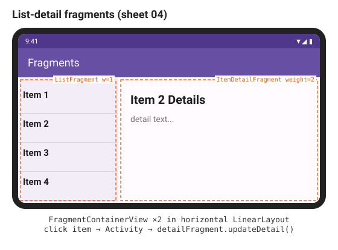

# 04 · Fragments

[⬅ Index](../README.md)



**Lifecycle:** onAttach → onCreate → **onCreateView** (inflate) → **onViewCreated** (findViewById, listeners) → onStart → onResume → onPause → onStop → onDestroyView → onDestroy → onDetach

## 1. Fragment classes
```java
public class ItemListFragment extends Fragment {

    public interface OnItemSelectedListener { void onItemSelected(String item); }
    private OnItemSelectedListener listener;

    @Override
    public void onAttach(@NonNull Context context) {
        super.onAttach(context);
        if (context instanceof OnItemSelectedListener) listener = (OnItemSelectedListener) context;
        else throw new ClassCastException(context + " must implement OnItemSelectedListener");
    }

    @Override
    public View onCreateView(@NonNull LayoutInflater inflater, ViewGroup container, Bundle b) {
        return inflater.inflate(R.layout.item_list_fragment, container, false);
    }

    @Override
    public void onViewCreated(@NonNull View view, Bundle b) {
        super.onViewCreated(view, b);
        view.findViewById(R.id.item1).setOnClickListener(v -> listener.onItemSelected("Item 1 Details"));
        view.findViewById(R.id.item2).setOnClickListener(v -> listener.onItemSelected("Item 2 Details"));
    }
}
```
```java
public class ItemDetailFragment extends Fragment {
    private TextView detailTV;

    @Override
    public View onCreateView(@NonNull LayoutInflater inflater, ViewGroup container, Bundle b) {
        View view = inflater.inflate(R.layout.item_detail_fragment, container, false);
        detailTV = view.findViewById(R.id.item_detail_text);
        return view;
    }
    public void updateDetail(String detail) { if (detailTV != null) detailTV.setText(detail); }
}
```
Import `androidx.fragment.app.Fragment`.

## 2a. Static (in XML)
```xml
<LinearLayout xmlns:android="http://schemas.android.com/apk/res/android"
    android:layout_width="match_parent" android:layout_height="match_parent"
    android:orientation="horizontal">
    <androidx.fragment.app.FragmentContainerView
        android:id="@+id/fragment_list"
        android:name="com.example.myapp.ItemListFragment"
        android:layout_width="0dp" android:layout_height="match_parent" android:layout_weight="1"/>
    <androidx.fragment.app.FragmentContainerView
        android:id="@+id/fragment_detail"
        android:name="com.example.myapp.ItemDetailFragment"
        android:layout_width="0dp" android:layout_height="match_parent" android:layout_weight="2"/>
</LinearLayout>
```
```java
public class MainActivity extends AppCompatActivity implements ItemListFragment.OnItemSelectedListener {
    @Override protected void onCreate(Bundle s) { super.onCreate(s); setContentView(R.layout.activity_main); }
    @Override public void onItemSelected(String item) {
        ItemDetailFragment f = (ItemDetailFragment) getSupportFragmentManager().findFragmentById(R.id.fragment_detail);
        if (f != null) f.updateDetail(item);
    }
}
```

## 2b. Dynamic (FragmentTransaction)
```xml
<FrameLayout android:id="@+id/container" android:layout_width="match_parent" android:layout_height="0dp" android:layout_weight="1"/>
```
```java
if (savedInstanceState == null) {               // avoid duplicates on rotation
    getSupportFragmentManager().beginTransaction()
        .replace(R.id.container, new ItemListFragment())
        .commit();
}

private void show(Fragment f) {
    getSupportFragmentManager().beginTransaction()
        .replace(R.id.container, f)
        .addToBackStack(null)        // Back returns to previous fragment
        .commit();
}
```

## Pass arguments
```java
public static DetailFragment newInstance(String title) {
    DetailFragment f = new DetailFragment();
    Bundle args = new Bundle();
    args.putString("TITLE", title);
    f.setArguments(args);
    return f;
}
// in onViewCreated:
String title = getArguments() != null ? getArguments().getString("TITLE") : "";
```

## Inside a fragment
- Context: `requireContext()`, `requireActivity()`
- Shared ViewModel: `new ViewModelProvider(requireActivity()).get(SharedVM.class)`, observed with `getViewLifecycleOwner()`
