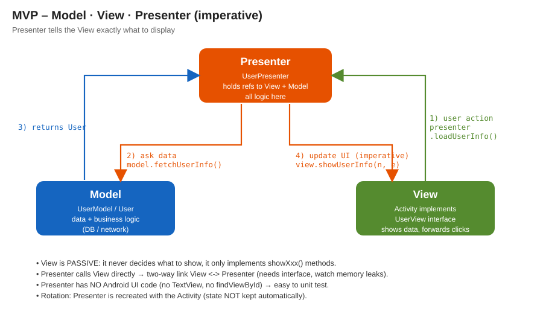
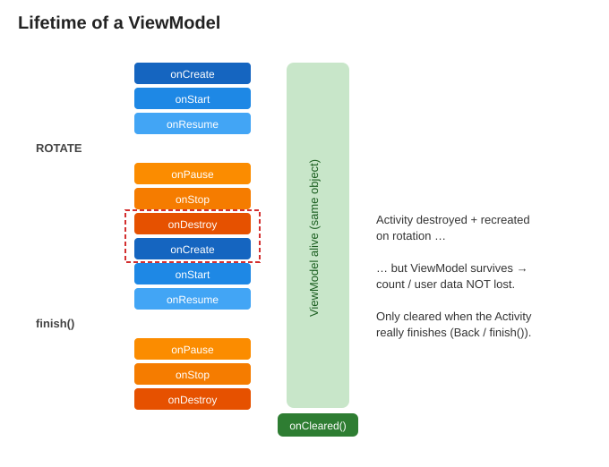
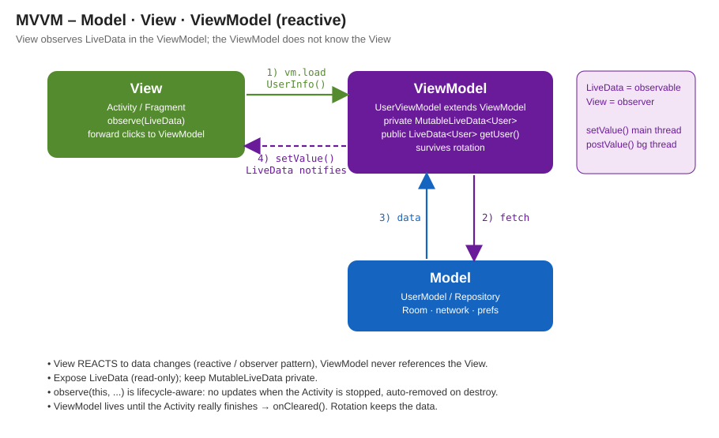
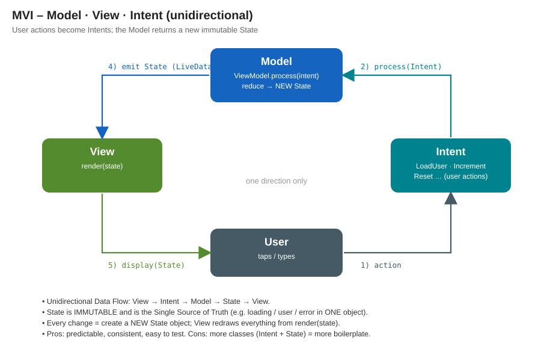
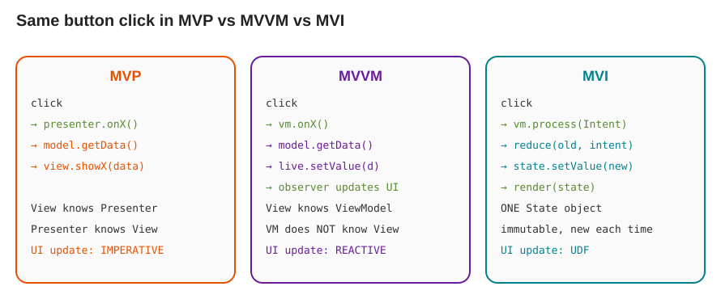

# 05 · Architecture: MVP / MVVM / MVI (+ LiveData & ViewModel)

[⬅ Index](../README.md) · Same counter app in all 3 patterns: [**T6**](../templates/T6-architecture-counter.md)

## Contents
1. [Why architecture? (Separation of Concerns)](#1-why-architecture)
2. [MVP](#2-mvp--model-view-presenter) — full lecture example (Java + Kotlin)
3. [Observer pattern, LiveData, ViewModel lifetime](#3-observer-pattern-livedata-viewmodel)
4. [MVVM](#4-mvvm--model-view-viewmodel) — full lecture example (Java + Kotlin)
5. [MVI](#5-mvi--model-view-intent) — full example with Loading/Success/Error state (Java + Kotlin)
6. [Comparison tables](#6-comparison)
7. [Exam recipe: convert ANY app to MVP / MVVM / MVI](#7-exam-recipe-convert-any-app)
8. [Marking checklist & common mistakes](#8-marking-checklist--common-mistakes)
9. [Short theory Q&A](#9-short-theory-qa)

---
## 1. Why architecture?
**Problem: the "God Activity".** One `MainActivity` draws buttons, applies rules, saves settings and sends commands. Every UI change or new feature edits the same file, and teammates collide in the same code.

**Separation of Concerns:** each part has ONE clear responsibility.

| Layer | Responsibility | Android class |
|---|---|---|
| **UI** | show status, capture taps | Activity / Fragment + `res/layout` |
| **Application logic** | apply rules, coordinate actions | Presenter / ViewModel |
| **Data** | database, web service, prefs | Model / Repository (Room, network) |

Bad practice (from the lecture):
- Business logic inside the Activity
- Hard-coded user-facing strings (use `strings.xml`)
- Copy-pasting code blindly
- Designing for one specific device

Good architecture:
- Clear place for each piece of logic
- Easier collaboration
- **Easier to test**
- Less technical debt

> Without architecture you get short-term hacks → **technical debt** → harder maintenance.

---
## 2. MVP – Model View Presenter


| Part | Does |
|---|---|
| **Model** | data + business logic (DB / web service) |
| **View** | Activity/Fragment implementing a **View interface**. Displays data; **notifies the Presenter** of user actions. Depends on the Presenter for *what to display* and *how to respond*. |
| **Presenter** | holds references to **View + Model**. Gets data from the Model and updates the View; processes user actions to update the Model. |

### Layout `activity_user.xml` (used by MVP, MVVM and MVI examples)
```xml
<LinearLayout xmlns:android="http://schemas.android.com/apk/res/android"
    android:layout_width="match_parent"
    android:layout_height="match_parent"
    android:orientation="vertical"
    android:padding="16dp">

    <TextView
        android:id="@+id/nameTextView"
        android:layout_width="wrap_content"
        android:layout_height="wrap_content"
        android:text="Name will appear here" />

    <TextView
        android:id="@+id/emailTextView"
        android:layout_width="wrap_content"
        android:layout_height="wrap_content"
        android:text="Email will appear here" />

    <Button
        android:id="@+id/loadUserButton"
        android:layout_width="wrap_content"
        android:layout_height="wrap_content"
        android:text="Load User Info" />
</LinearLayout>
```

### Model — `User.java` + `UserModel.java`
```java
public class User {
    private final String name;
    private final String email;
    public User(String name, String email) { this.name = name; this.email = email; }
    public String getName()  { return name; }
    public String getEmail() { return email; }
}
```
```java
public class UserModel {
    // Simulates fetching user info from a data source (DB / cloud)
    public User fetchUserInfo() {
        return new User("John Doe", "john.doe@example.com");
    }
}
```

### View interface — `UserView.java`
```java
public interface UserView {
    void showUserInfo(String name, String email);
    void showError(String message);
}
```

### Presenter — `UserPresenter.java`
```java
public class UserPresenter {
    private UserView userView;            // reference to View
    private final UserModel userModel;    // reference to Model

    public UserPresenter(UserView userView) {
        this.userView = userView;
        this.userModel = new UserModel();
    }

    // All data/UI processing logic lives here
    public void loadUserInfo() {
        User user = userModel.fetchUserInfo();
        if (userView == null) return;     // view already destroyed
        if (user != null) {
            userView.showUserInfo(user.getName(), user.getEmail());
        } else {
            userView.showError("Failed to load user info.");
        }
    }

    // Extra (good practice): avoid leaking the Activity
    public void detachView() { userView = null; }
}
```

### View implementation — `UserActivity.java`
```java
public class UserActivity extends AppCompatActivity implements UserView {

    private UserPresenter presenter;
    private TextView nameTextView, emailTextView;

    @Override
    protected void onCreate(Bundle savedInstanceState) {
        super.onCreate(savedInstanceState);
        setContentView(R.layout.activity_user);

        nameTextView  = findViewById(R.id.nameTextView);
        emailTextView = findViewById(R.id.emailTextView);
        Button loadUserButton = findViewById(R.id.loadUserButton);

        presenter = new UserPresenter(this);                       // 1. create presenter

        loadUserButton.setOnClickListener(v -> presenter.loadUserInfo()); // 2. pass user action
    }

    @Override public void showUserInfo(String name, String email) {    // 3. presenter calls back
        nameTextView.setText(name);
        emailTextView.setText(email);
    }

    @Override public void showError(String message) {
        Toast.makeText(this, message, Toast.LENGTH_SHORT).show();
    }

    @Override protected void onDestroy() {
        presenter.detachView();
        super.onDestroy();
    }
}
```

### MVP in Kotlin
```kotlin
data class User(val name: String, val email: String)

class UserModel { fun fetchUserInfo(): User = User("John Doe", "john.doe@example.com") }

interface UserView {
    fun showUserInfo(name: String, email: String)
    fun showError(message: String)
}

class UserPresenter(private var userView: UserView?) {
    private val userModel = UserModel()
    fun loadUserInfo() {
        val user = userModel.fetchUserInfo()
        userView?.showUserInfo(user.name, user.email)
    }
    fun detachView() { userView = null }
}

class UserActivity : AppCompatActivity(), UserView {
    private lateinit var presenter: UserPresenter
    private lateinit var nameTextView: TextView
    private lateinit var emailTextView: TextView

    override fun onCreate(savedInstanceState: Bundle?) {
        super.onCreate(savedInstanceState)
        setContentView(R.layout.activity_user)
        nameTextView = findViewById(R.id.nameTextView)
        emailTextView = findViewById(R.id.emailTextView)
        presenter = UserPresenter(this)
        findViewById<Button>(R.id.loadUserButton).setOnClickListener { presenter.loadUserInfo() }
    }
    override fun showUserInfo(name: String, email: String) { nameTextView.text = name; emailTextView.text = email }
    override fun showError(message: String) { Toast.makeText(this, message, Toast.LENGTH_SHORT).show() }
    override fun onDestroy() { presenter.detachView(); super.onDestroy() }
}
```

### Contract style (optional, common in real projects)
```java
public interface UserContract {
    interface View      { void showUserInfo(String n, String e); void showError(String m); }
    interface Presenter { void loadUserInfo(); void detachView(); }
}
// class UserPresenter implements UserContract.Presenter
// class UserActivity extends AppCompatActivity implements UserContract.View
```

**MVP key points**
- Decouples View and Model; **two-way** communication View ⇄ Presenter.
- ✅ Good for small/medium projects; clear logic; testable; UI logic separate from business logic.
- ❌ The Presenter can become **overloaded** as complexity grows.
- ❌ You must manage lifecycle **manually**: `detachView()`, and state is lost on rotation.

---
## 3. Observer pattern, LiveData, ViewModel
**Reactive vs imperative**
- **Imperative (MVP):** the developer explicitly tells the UI when and how to update.
- **Reactive (MVVM/MVI):** the UI reacts to changes in observable data.

**Observer pattern:** a *subject* (Observable) keeps a list of *observers* and notifies them when its state changes. Observers can be added or removed at any time. In Android, LiveData is the Observable and the Activity/Fragment is the Observer.

### LiveData vs MutableLiveData
| `LiveData<T>` | `MutableLiveData<T>` |
|---|---|
| `getValue()` only (read-only) | `getValue()`, `setValue(T)` (main thread), `postValue(T)` (any thread) |
| exposed **publicly** to the View | kept **private** inside the ViewModel |

```java
private final MutableLiveData<Integer> count = new MutableLiveData<>(0);   // private, writable
public LiveData<Integer> getCount() { return count; }                     // public, read-only
```
```java
// View
vm.getCount().observe(this, c -> countTV.setText(String.valueOf(c)));   // owner = this (LifecycleOwner)
// in a Fragment use getViewLifecycleOwner() instead of this
```
- **Lifecycle-aware:** the observer only receives updates while the owner is STARTED or RESUMED, and is removed automatically on DESTROYED. No memory leaks.
- `observe()` immediately delivers the **current value** to a new observer, so after rotation the UI refills automatically.
- From a background thread use `postValue()`. Calling `setValue()` there crashes.
- Also available: `removeObserver(observer)` and `observeForever(observer)` (must be removed manually).

### ViewModel lifetime


```java
vm = new ViewModelProvider(this).get(UserViewModel.class);   // NEVER "new UserViewModel()"
```
- The same ViewModel instance is returned after rotation. Its lifetime is decided by the **ViewModelStoreOwner** (Activity/Fragment).
- `onCleared()` runs when the owner finishes for good. Cancel work there.
- ⚠️ Never store an Activity, View or Context in a ViewModel (memory leak). If you need a Context, use `AndroidViewModel(Application)`.

Gradle (usually already included with `appcompat`/`material`):
```kotlin
implementation("androidx.lifecycle:lifecycle-viewmodel:2.6.2")
implementation("androidx.lifecycle:lifecycle-livedata:2.6.2")
// Kotlin "by viewModels()": implementation("androidx.activity:activity-ktx:1.8.2")
```

---
## 4. MVVM – Model View ViewModel


| Part | Does |
|---|---|
| **Model** | data storage + business logic (network, DB); exposes data to the ViewModel |
| **View** | interacts with the user and displays data; **actively notifies** the ViewModel of actions; **observes** the ViewModel to update the UI **reactively** |
| **ViewModel** | holds UI data and prepares it for display; processes actions with the Model; **exposes observable streams (LiveData)**. It has **no reference to the View**. |

### ViewModel — `UserViewModel.java`
```java
import androidx.lifecycle.LiveData;
import androidx.lifecycle.MutableLiveData;
import androidx.lifecycle.ViewModel;

public class UserViewModel extends ViewModel {
    private final MutableLiveData<User> userLiveData = new MutableLiveData<>();  // private
    private final MutableLiveData<String> errorLiveData = new MutableLiveData<>();
    private final UserModel userModel;

    public UserViewModel() { userModel = new UserModel(); }

    public LiveData<User> getUser()    { return userLiveData; }    // expose immutable LiveData
    public LiveData<String> getError() { return errorLiveData; }

    public void loadUserInfo() {
        User user = userModel.fetchUserInfo();
        if (user != null) userLiveData.setValue(user);
        else errorLiveData.setValue("Failed to load user info.");
    }
}
```

### View — `UserActivity.java`
```java
import androidx.lifecycle.ViewModelProvider;

public class UserActivity extends AppCompatActivity {

    private UserViewModel userViewModel;
    private TextView nameTextView, emailTextView;

    @Override
    protected void onCreate(Bundle savedInstanceState) {
        super.onCreate(savedInstanceState);
        setContentView(R.layout.activity_user);

        nameTextView  = findViewById(R.id.nameTextView);
        emailTextView = findViewById(R.id.emailTextView);
        Button loadUserButton = findViewById(R.id.loadUserButton);

        userViewModel = new ViewModelProvider(this).get(UserViewModel.class);

        // Observe: UI updates itself whenever the data changes
        userViewModel.getUser().observe(this, user -> {
            if (user != null) {
                nameTextView.setText(user.getName());
                emailTextView.setText(user.getEmail());
            }
        });
        userViewModel.getError().observe(this, msg ->
                Toast.makeText(this, msg, Toast.LENGTH_SHORT).show());

        // Notify ViewModel of user action
        loadUserButton.setOnClickListener(v -> userViewModel.loadUserInfo());
    }
}
```
Notice that the Activity **no longer implements an interface**, and there's no `showUserInfo()` method.

### MVVM in Kotlin
```kotlin
class UserViewModel : ViewModel() {
    private val userLiveData = MutableLiveData<User>()
    private val userModel = UserModel()

    fun getUser(): LiveData<User> = userLiveData        // or: val user: LiveData<User> = userLiveData

    fun loadUserInfo() {
        userLiveData.value = userModel.fetchUserInfo()
    }
}

class UserActivity : AppCompatActivity() {
    private lateinit var userViewModel: UserViewModel

    override fun onCreate(savedInstanceState: Bundle?) {
        super.onCreate(savedInstanceState)
        setContentView(R.layout.activity_user)
        val nameTextView = findViewById<TextView>(R.id.nameTextView)
        val emailTextView = findViewById<TextView>(R.id.emailTextView)

        userViewModel = ViewModelProvider(this).get(UserViewModel::class.java)

        userViewModel.getUser().observe(this) { user ->
            user?.let { nameTextView.text = it.name; emailTextView.text = it.email }
        }
        findViewById<Button>(R.id.loadUserButton).setOnClickListener { userViewModel.loadUserInfo() }
    }
}
```

### MVVM + background loading (postValue)
```java
public class UserViewModel extends ViewModel {
    private final MutableLiveData<Boolean> loading = new MutableLiveData<>(false);
    private final MutableLiveData<User> user = new MutableLiveData<>();
    private final ExecutorService io = Executors.newSingleThreadExecutor();
    private final UserModel model = new UserModel();

    public LiveData<Boolean> isLoading() { return loading; }
    public LiveData<User> getUser() { return user; }

    public void loadUserInfo() {
        loading.setValue(true);                       // main thread
        io.execute(() -> {
            try { Thread.sleep(1500); } catch (InterruptedException ignored) {}
            user.postValue(model.fetchUserInfo());    // background thread → postValue
            loading.postValue(false);
        });
    }

    @Override protected void onCleared() { io.shutdownNow(); }   // ViewModel destroyed
}
// View: vm.isLoading().observe(this, l -> progressBar.setVisibility(l ? View.VISIBLE : View.GONE));
```

### MVVM + Room (Repository, AndroidViewModel)
```java
public class NoteViewModel extends AndroidViewModel {
    private final NoteDao dao;
    private final LiveData<List<Note>> notes;
    private final ExecutorService io = Executors.newSingleThreadExecutor();

    public NoteViewModel(@NonNull Application app) {
        super(app);
        dao = AppDatabase.getInstance(app).noteDao();
        notes = dao.getAll();                  // Room returns LiveData directly
    }
    public LiveData<List<Note>> getNotes() { return notes; }
    public void add(String title) { io.execute(() -> dao.insert(new Note(title, "", System.currentTimeMillis()))); }
}
// View: vm.getNotes().observe(this, list -> adapter.setData(list));
```

### Two-way DataBinding (optional, MVVM bonus)
See [sheet 10](10-viewbinding-databinding.md). `android:text="@={viewModel.name}"` + `binding.setLifecycleOwner(this)`.

---
## 5. MVI – Model View Intent


| Part | Does |
|---|---|
| **Model** | an **unchangeable State object**. When something changes, a **new State** is created. Implemented with a ViewModel + LiveData. |
| **View** | displays the UI from the **current state**; turns user interactions into **Intents**; a **passive observer** of state updates |
| **Intent** | represents a **user action** (not `android.content.Intent`!). The Model responds to Intents by issuing a new State. |

**Unidirectional Data Flow:** View → Intent → Model → (new State) → View.
- ✅ Predictability, consistency, ease of testing.
- ❌ More classes and boilerplate (Intent + State).

**State = Single Source of Truth.** It is the *UI perspective* of the Model: everything the screen needs goes in ONE object.

### Intent — `UserIntent.java` (one class per user action)
```java
public abstract class UserIntent {
    private UserIntent() {}                                    // only the subclasses below
    public static final class LoadUser extends UserIntent {}   // "Load" button
    public static final class ClearUser extends UserIntent {}  // "Clear" button (multiple intents OK)
}
```

### State — `UserState.java` (immutable: `final` fields, no setters)
```java
public final class UserState {
    public final boolean isLoading;
    public final User user;          // null if not loaded
    public final String error;       // null if no error

    public UserState(boolean isLoading, User user, String error) {
        this.isLoading = isLoading; this.user = user; this.error = error;
    }

    // factory helpers make the ViewModel easy to read
    public static UserState idle()             { return new UserState(false, null, null); }
    public static UserState loading()          { return new UserState(true,  null, null); }
    public static UserState success(User u)    { return new UserState(false, u,    null); }
    public static UserState error(String msg)  { return new UserState(false, null, msg);  }
}
```

### Model (ViewModel) — `UserMviViewModel.java`
```java
public class UserMviViewModel extends ViewModel {

    private final MutableLiveData<UserState> state = new MutableLiveData<>(UserState.idle());
    private final UserModel userModel = new UserModel();
    private final ExecutorService io = Executors.newSingleThreadExecutor();

    public LiveData<UserState> getState() { return state; }   // View observes ONE stream

    // Single entry point for ALL user actions
    public void processIntent(UserIntent intent) {
        if (intent instanceof UserIntent.LoadUser) {
            loadUser();
        } else if (intent instanceof UserIntent.ClearUser) {
            state.setValue(UserState.idle());                  // new state
        }
    }

    private void loadUser() {
        state.setValue(UserState.loading());                   // new state
        io.execute(() -> {
            try { Thread.sleep(1000); } catch (InterruptedException ignored) {}
            User u = userModel.fetchUserInfo();
            state.postValue(u != null ? UserState.success(u)   // new state
                                      : UserState.error("Failed to load user info."));
        });
    }

    @Override protected void onCleared() { io.shutdownNow(); }
}
```
(Synchronous version, like the lecture: `state.setValue(new UserState(false, userModel.fetchUserInfo(), null));`)

### View — `UserActivity.java`
```java
public class UserActivity extends AppCompatActivity {

    private UserMviViewModel vm;
    private TextView nameTextView, emailTextView;
    private ProgressBar progressBar;      // add <ProgressBar android:id="@+id/progressBar" .../> to layout

    @Override
    protected void onCreate(Bundle savedInstanceState) {
        super.onCreate(savedInstanceState);
        setContentView(R.layout.activity_user);

        nameTextView  = findViewById(R.id.nameTextView);
        emailTextView = findViewById(R.id.emailTextView);
        progressBar   = findViewById(R.id.progressBar);

        vm = new ViewModelProvider(this).get(UserMviViewModel.class);

        // Observe the new state and update accordingly
        vm.getState().observe(this, this::render);

        // Transform user actions into Intents
        findViewById(R.id.loadUserButton).setOnClickListener(v ->
                vm.processIntent(new UserIntent.LoadUser()));
    }

    /** Draw the WHOLE screen from the state. No other method changes the UI. */
    private void render(UserState s) {
        progressBar.setVisibility(s.isLoading ? View.VISIBLE : View.GONE);
        if (s.user != null) {
            nameTextView.setText(s.user.getName());
            emailTextView.setText(s.user.getEmail());
        } else {
            nameTextView.setText("Name will appear here");
            emailTextView.setText("Email will appear here");
        }
        if (s.error != null) Toast.makeText(this, s.error, Toast.LENGTH_SHORT).show();
    }
}
```

### MVI in Kotlin (sealed class + data class)
```kotlin
sealed class UserIntent {
    object LoadUser : UserIntent()
    object ClearUser : UserIntent()
}

data class UserState(                       // val = immutable
    val isLoading: Boolean = false,
    val user: User? = null,
    val error: String? = null
)

class UserMviViewModel : ViewModel() {
    private val _state = MutableLiveData(UserState())
    val state: LiveData<UserState> = _state
    private val userModel = UserModel()

    fun processIntent(intent: UserIntent) {
        when (intent) {                                    // exhaustive thanks to sealed class
            is UserIntent.LoadUser -> {
                _state.value = _state.value!!.copy(isLoading = true)       // copy() = new state
                _state.value = UserState(user = userModel.fetchUserInfo()) // new state
            }
            is UserIntent.ClearUser -> _state.value = UserState()
        }
    }
}

class UserActivity : AppCompatActivity() {
    private val vm: UserMviViewModel by viewModels()   // or ViewModelProvider(this)[UserMviViewModel::class.java]
    override fun onCreate(savedInstanceState: Bundle?) {
        super.onCreate(savedInstanceState)
        setContentView(R.layout.activity_user)
        val name = findViewById<TextView>(R.id.nameTextView)
        val email = findViewById<TextView>(R.id.emailTextView)

        vm.state.observe(this) { s ->                  // render(state)
            name.text = s.user?.name ?: "Name will appear here"
            email.text = s.user?.email ?: "Email will appear here"
            s.error?.let { Toast.makeText(this, it, Toast.LENGTH_SHORT).show() }
        }
        findViewById<Button>(R.id.loadUserButton).setOnClickListener {
            vm.processIntent(UserIntent.LoadUser)
        }
    }
}
```

---
## 6. Comparison


| Aspect | MVP | MVVM | MVI |
|---|---|---|---|
| Middle layer | Presenter | ViewModel | ViewModel (as Model/reducer) |
| Middle layer knows View? | **Yes** (via interface) | **No** | **No** |
| UI update | **Imperative**: `view.showX()` | **Reactive**: observe LiveData | **Reactive**: observe ONE State |
| Data flow | two-way | View → VM (calls), VM → View (observe) | **Unidirectional** loop |
| State | spread in Presenter/View | several LiveData fields | one immutable State object |
| User actions | method calls `presenter.onX()` | method calls `vm.onX()` | Intent objects `process(new X())` |
| Lifecycle | manual (detach, lost on rotate) | automatic, survives rotation | automatic, survives rotation |
| Boilerplate | interface + presenter | low | highest (Intent + State classes) |
| Testability | good (mock the View) | high | high (pure state → state) |
| Two-way data binding | ✗ | ✓ | (not typical) |
| Best for | small, simple UIs | most apps, multiple data sources | complex screens with many states |
| Main risk | **overloaded Presenter** | **bloated ViewModel**, many separate LiveData fields → messy flow | complexity of immutable states + intents |

**Common to all:** Separation of Concerns, and logic is testable without Android UI classes.

**Lecture summary**
- **MVP:** separates UI from business logic; the Presenter *explicitly* coordinates UI updates.
- **MVVM:** reactive UI through observables; the ViewModel decouples UI state from the Activity lifecycle, so it survives configuration changes.
- **MVI:** explicit UI state and unidirectional data flow make state transitions predictable and traceable.
- **No architecture is universally best.** Pick the one that manages your app's complexity.

---
## 7. Exam recipe: convert ANY app
Start from your plain working Activity, then move code out of it.

### → MVP (4 files)
1. **Model**: `XxxModel.java`. Move data/calculation code here (e.g. `calcBmi(h, w)`, counter rules, prefs/DB access).
2. **View interface**: `XxxView.java`. One method per UI change: `showResult(String)`, `showError(String)`, `setCountColor(int)` …
3. **Presenter**: `XxxPresenter.java`. Constructor `(XxxView view)`; one public method per user action: `onCalculateClicked(String h, String w)`. Validate, call the Model, then call `view.showXxx()`.
4. **Activity** `implements XxxView`. `onCreate`: findViewById + `presenter = new XxxPresenter(this)`; listeners only call presenter methods; implement the show methods with `setText`, `Toast` etc. `onDestroy` → `presenter.detachView()`.

### → MVVM (3 files)
1. **Model**: same as above.
2. **ViewModel** `extends ViewModel`. One `private MutableLiveData` per piece of UI data + a public `LiveData` getter; one public method per user action that updates the LiveData.
3. **Activity**: `vm = new ViewModelProvider(this).get(...)`; `observe()` every LiveData in `onCreate`; listeners call vm methods. **No logic in the Activity.**

### → MVI (5 files)
1. **Model** (data source), same as above.
2. **Intent**: abstract class + one static subclass per user action (put data in fields, e.g. `Calculate(double h, double w)`).
3. **State**: final class with `final` fields for EVERYTHING on screen + factory methods.
4. **ViewModel**: `MutableLiveData<State>`, `processIntent(Intent)` with `instanceof` checks, and **always** `setValue(new State(...))`.
5. **Activity**: listeners → `vm.processIntent(new X())`; one `observe(this, this::render)`; `render(State)` sets every view.

### Intent with data (MVI)
```java
public abstract class BmiIntent {
    public static final class Calculate extends BmiIntent {
        public final String height, weight;
        public Calculate(String h, String w) { height = h; weight = w; }
    }
    public static final class Clear extends BmiIntent {}
}
// View: vm.processIntent(new BmiIntent.Calculate(hET.getText().toString(), wET.getText().toString()));
// VM:   if (i instanceof BmiIntent.Calculate) { BmiIntent.Calculate c = (BmiIntent.Calculate) i; ... }
```

### Suggested package layout (looks tidy to markers)
```
com.example.app
├── model/      User.java, UserModel.java
├── view/       UserActivity.java, UserView.java (MVP)
├── presenter/  UserPresenter.java                (MVP)
├── viewmodel/  UserViewModel.java                (MVVM/MVI)
└── intent/     UserIntent.java, UserState.java   (MVI)
```
(Remember to move `MainActivity` in the manifest too if you change packages. Keeping everything in one package is fine.)

---
## 8. Marking checklist & common mistakes
**Checklist**
- [ ] Activity has **no business logic**: no calculations, no validation rules, no DB calls.
- [ ] Presenter/ViewModel has **no** `TextView`, `Button`, `findViewById`, `Toast` or `Context` (except `AndroidViewModel`).
- [ ] MVP: Activity `implements` the View interface; Presenter only talks to it through the interface.
- [ ] MVVM/MVI: ViewModel created with `ViewModelProvider`; LiveData **exposed read-only**.
- [ ] MVI: one State class, immutable (`final` fields), a NEW object every change; one `render()`.
- [ ] Rotate the emulator: data survives (MVVM/MVI). For MVP, mention that it doesn't, or save it in `onSaveInstanceState`.
- [ ] Comments naming each layer (`// Model`, `// View`, `// Presenter`) help markers.

| Mistake | Fix |
|---|---|
| `new MyViewModel()` | `new ViewModelProvider(this).get(MyViewModel.class)` (otherwise it doesn't survive rotation) |
| Public `MutableLiveData` | private Mutable + public `LiveData` getter |
| Calling `observe()` inside a click listener | observe **once** in `onCreate` (otherwise you get duplicate observers) |
| `setValue()` from a background thread | `postValue()` |
| Passing the Activity into the ViewModel | never; use `AndroidViewModel` if you need a Context |
| MVI: changing a field of the old state | create a new State; make fields `final` |
| MVI: updating views outside `render()` | all UI changes go through `render(state)` |
| MVP: Presenter keeps the Activity after destroy | `detachView()` in `onDestroy` and null-check the view |
| Naming conflict `Intent` | call it `UserIntent` / `CounterIntent`, not `Intent` |
| Toast shows again after rotation (MVVM/MVI) | LiveData re-delivers the last value. Clear the error after showing it (e.g. `vm.errorShown()` sets it to `null`), or accept this for the exam |

---
## 9. Short theory Q&A
- **Why do we need architecture?** To avoid short-term hacks and technical debt, separate concerns, make code testable and maintainable, and let a team work in parallel.
- **MVP vs MVVM, the key difference?** In MVP the Presenter updates the View directly through an interface (imperative). In MVVM the View observes the ViewModel's LiveData and updates itself (reactive); the ViewModel has no reference to the View.
- **What do MVP and MVVM have in common?** Separation of concerns and better testability: the Presenter or ViewModel can be tested without Android UI libraries.
- **Why does MVVM data survive rotation?** The ViewModel is scoped to the ViewModelStoreOwner and not destroyed on configuration change; it is cleared only when the Activity finishes (`onCleared()`).
- **What is LiveData?** A lifecycle-aware, observable data holder. Observers get updates only while active and are removed automatically when destroyed.
- **setValue vs postValue?** `setValue` must be called on the main thread and applies immediately. `postValue` can be called from any thread and is applied on the main thread later.
- **What is an "Intent" in MVI?** A user action (e.g. `LoadUser`). It is not an Android `Intent`.
- **What is the State in MVI, and why make it immutable?** It's the single source of truth for the UI. Immutability means each change produces a new state, so transitions are predictable, traceable and consistent.
- **What is Unidirectional Data Flow?** Data moves one way: View → Intent → Model → State → View.
- **Weakness of each pattern?** MVP: an overloaded Presenter and manual lifecycle handling. MVVM: many independent LiveData fields → complex flows and a bloated ViewModel. MVI: more boilerplate from the Intent and State classes.
- **Which pattern is best?** None is universally best; choose based on the app's complexity and requirements.
