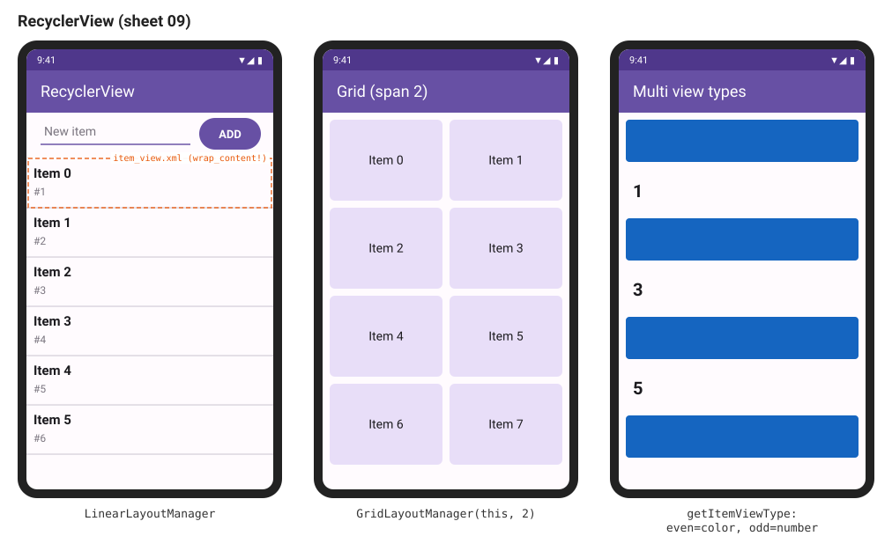

# 09 · RecyclerView

[⬅ Index](../README.md)



**4 steps:** ① `RecyclerView` in the layout → ② item layout XML → ③ Adapter + ViewHolder → ④ LayoutManager + Adapter in the Activity.

## ① activity layout
```xml
<androidx.recyclerview.widget.RecyclerView
    android:id="@+id/rv"
    android:layout_width="match_parent"
    android:layout_height="0dp"
    android:layout_weight="1" />
```

## ② res/layout/item_view.xml
```xml
<LinearLayout xmlns:android="http://schemas.android.com/apk/res/android"
    android:layout_width="match_parent"
    android:layout_height="wrap_content"
    android:orientation="horizontal"
    android:padding="12dp">
    <TextView android:id="@+id/titleTV" android:layout_width="0dp" android:layout_weight="1"
        android:layout_height="wrap_content" android:textSize="18sp"/>
    <TextView android:id="@+id/subTV" android:layout_width="wrap_content"
        android:layout_height="wrap_content"/>
</LinearLayout>
```
⚠️ The item root must use **wrap_content** for its height, or each row fills the whole screen.

## ③ Adapter (click + long click)
```java
public class ItemAdapter extends RecyclerView.Adapter<ItemAdapter.VH> {

    public interface OnItemClick { void onClick(int position); }
    public interface OnItemLongClick { void onLongClick(int position); }

    private final List<String> data;
    private final OnItemClick click;
    private final OnItemLongClick longClick;

    public ItemAdapter(List<String> data, OnItemClick click, OnItemLongClick longClick) {
        this.data = data; this.click = click; this.longClick = longClick;
    }

    static class VH extends RecyclerView.ViewHolder {
        TextView title, sub;
        VH(@NonNull View row) {
            super(row);
            title = row.findViewById(R.id.titleTV);
            sub = row.findViewById(R.id.subTV);
        }
    }

    @NonNull @Override
    public VH onCreateViewHolder(@NonNull ViewGroup parent, int viewType) {
        View v = LayoutInflater.from(parent.getContext()).inflate(R.layout.item_view, parent, false);
        return new VH(v);
    }

    @Override
    public void onBindViewHolder(@NonNull VH h, int position) {
        h.title.setText(data.get(position));
        h.sub.setText("#" + (position + 1));
        h.itemView.setOnClickListener(v -> click.onClick(h.getAdapterPosition()));
        h.itemView.setOnLongClickListener(v -> { longClick.onLongClick(h.getAdapterPosition()); return true; });
    }

    @Override public int getItemCount() { return data.size(); }

    public void setData(List<String> newData) { data.clear(); data.addAll(newData); notifyDataSetChanged(); }
}
```

## ④ Activity
```java
private final List<String> items = new ArrayList<>();
private ItemAdapter adapter;

RecyclerView rv = findViewById(R.id.rv);
rv.setLayoutManager(new LinearLayoutManager(this));
rv.addItemDecoration(new DividerItemDecoration(this, DividerItemDecoration.VERTICAL));
adapter = new ItemAdapter(items,
    pos -> Toast.makeText(this, "Clicked " + items.get(pos), Toast.LENGTH_SHORT).show(),
    pos -> { items.remove(pos); adapter.notifyItemRemoved(pos); });
rv.setAdapter(adapter);

// add
items.add("New");
adapter.notifyItemInserted(items.size() - 1);
```
Notify methods: `notifyItemInserted`, `notifyItemRemoved`, `notifyItemChanged`, and `notifyDataSetChanged` (when you replace the whole list).

## Click → dialog with details (exam bonus pattern)
```java
adapter = new RecordAdapter(r -> new AlertDialog.Builder(this)
        .setTitle(r.date)
        .setMessage(r.note == null || r.note.isEmpty() ? "No remark" : r.note)
        .setPositiveButton("OK", null).show());
```

## Kotlin Adapter
```kotlin
class IntAdapter(private val data: List<Int>, private val onClick: (Int) -> Unit)
    : RecyclerView.Adapter<IntAdapter.VH>() {
    class VH(row: View) : RecyclerView.ViewHolder(row) { val tv: TextView = row.findViewById(R.id.titleTV) }
    override fun onCreateViewHolder(parent: ViewGroup, viewType: Int) =
        VH(LayoutInflater.from(parent.context).inflate(R.layout.item_view, parent, false))
    override fun onBindViewHolder(h: VH, position: Int) {
        h.tv.text = data[position].toString()
        h.itemView.setOnClickListener { onClick(data[position]) }
    }
    override fun getItemCount() = data.size
}
```

## ListAdapter + DiffUtil
```java
public class IntListAdapter extends ListAdapter<Integer, IntListAdapter.VH> {
    public IntListAdapter() { super(DIFF); }
    private static final DiffUtil.ItemCallback<Integer> DIFF = new DiffUtil.ItemCallback<Integer>() {
        @Override public boolean areItemsTheSame(@NonNull Integer a, @NonNull Integer b) { return a.equals(b); }
        @Override public boolean areContentsTheSame(@NonNull Integer a, @NonNull Integer b) { return a.equals(b); }
    };
    static class VH extends RecyclerView.ViewHolder { TextView tv; VH(View v) { super(v); tv = v.findViewById(R.id.titleTV); } }
    @NonNull @Override public VH onCreateViewHolder(@NonNull ViewGroup p, int t) {
        return new VH(LayoutInflater.from(p.getContext()).inflate(R.layout.item_view, p, false));
    }
    @Override public void onBindViewHolder(@NonNull VH h, int pos) { h.tv.setText(String.valueOf(getItem(pos))); }
}
// adapter.submitList(new ArrayList<>(data));   // always submit a NEW list
```

## Multiple view types
```java
@Override public int getItemViewType(int position) { return position % 2 == 0 ? TYPE_COLOR : TYPE_NUMBER; }

@NonNull @Override
public RecyclerView.ViewHolder onCreateViewHolder(@NonNull ViewGroup parent, int viewType) {
    LayoutInflater inf = LayoutInflater.from(parent.getContext());
    if (viewType == TYPE_NUMBER) return new NumberVH(inf.inflate(R.layout.item_number, parent, false));
    return new ColorVH(inf.inflate(R.layout.item_color, parent, false));
}
@Override public void onBindViewHolder(@NonNull RecyclerView.ViewHolder h, int pos) {
    if (h instanceof NumberVH) ((NumberVH) h).bind(data.get(pos)); else ((ColorVH) h).bind();
}
```

## Grid / horizontal
```java
rv.setLayoutManager(new GridLayoutManager(this, 2));
rv.setLayoutManager(new LinearLayoutManager(this, LinearLayoutManager.HORIZONTAL, false));
```

## Swipe to delete
```java
new ItemTouchHelper(new ItemTouchHelper.SimpleCallback(0, ItemTouchHelper.LEFT | ItemTouchHelper.RIGHT) {
    @Override public boolean onMove(@NonNull RecyclerView r, @NonNull RecyclerView.ViewHolder a, @NonNull RecyclerView.ViewHolder b) { return false; }
    @Override public void onSwiped(@NonNull RecyclerView.ViewHolder vh, int dir) {
        int pos = vh.getAdapterPosition();
        items.remove(pos); adapter.notifyItemRemoved(pos);
    }
}).attachToRecyclerView(rv);
```

## Simple ListView (when RecyclerView isn't required)
```java
ArrayAdapter<String> ad = new ArrayAdapter<>(this, android.R.layout.simple_list_item_1, items);
listView.setAdapter(ad);
listView.setOnItemClickListener((parent, view, pos, id) -> { });
```
