# 14 · Screen Gallery: What Each Layout Looks Like + How to Change It

[⬅ Index](../README.md)

Orange dashed boxes show the **layout containers**, so you can see which XML block to edit.

## 1. Size

## 2. padding vs margin
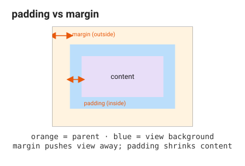

## 3. gravity vs layout_gravity
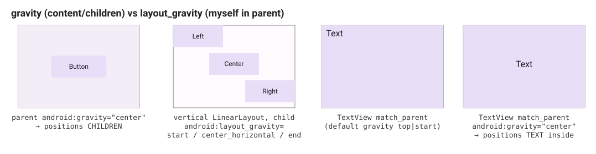

## 4. Linear / Table / Grid
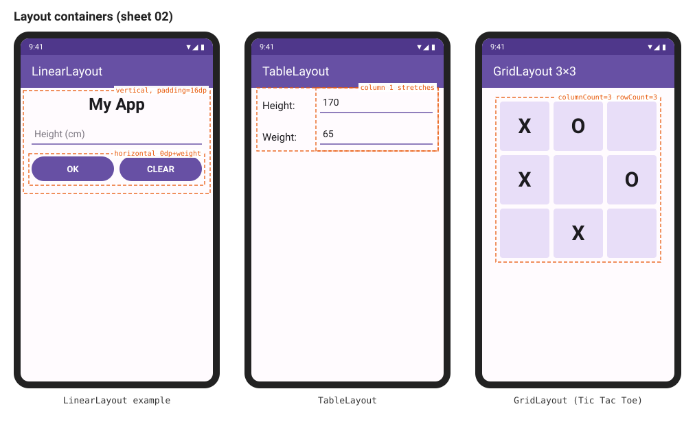

## 5. ConstraintLayout
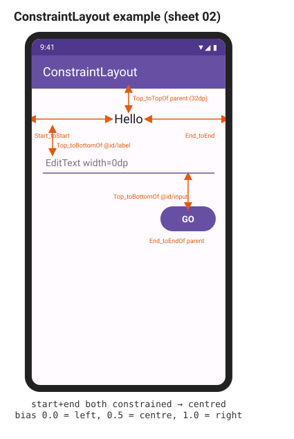

## 6. Widget gallery
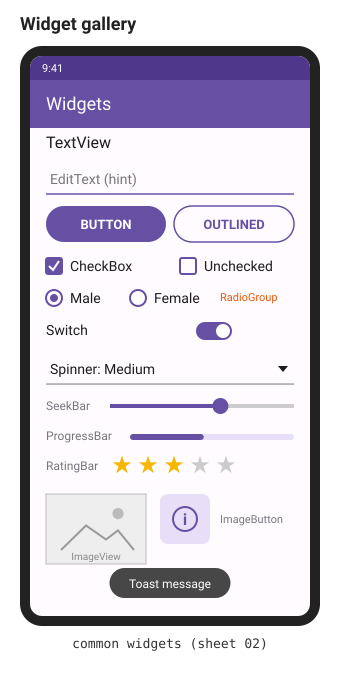

## 7. Menu & dialogs

## 8. Fragments

## 9. RecyclerView
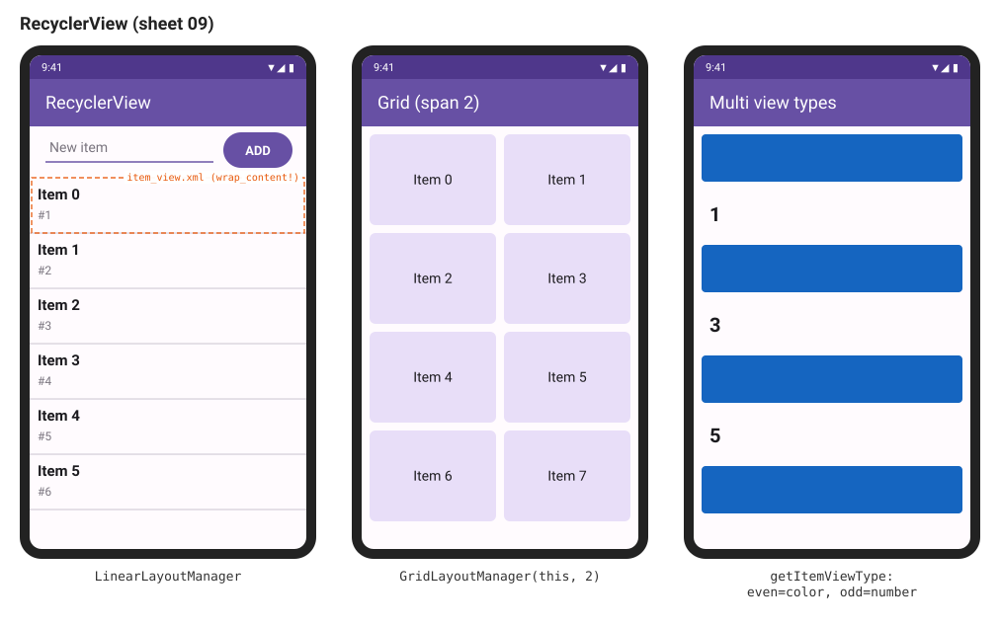

## 10. Architecture diagrams
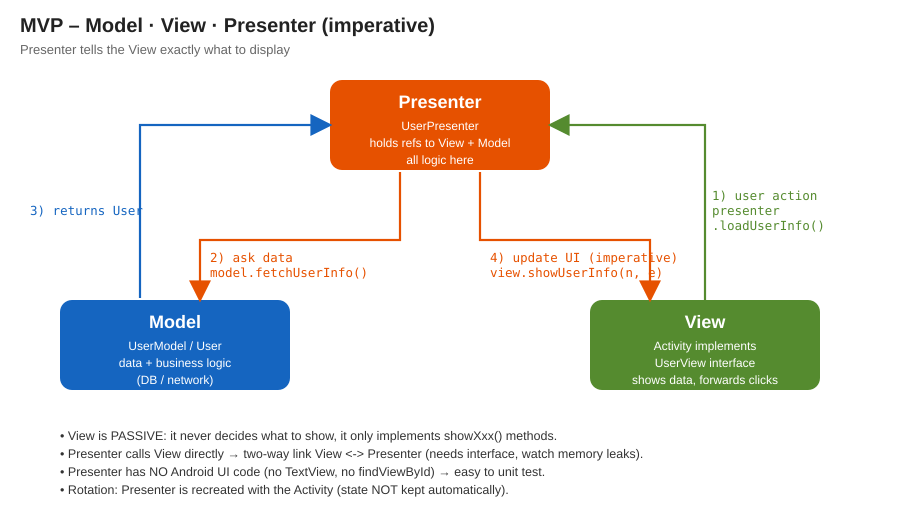
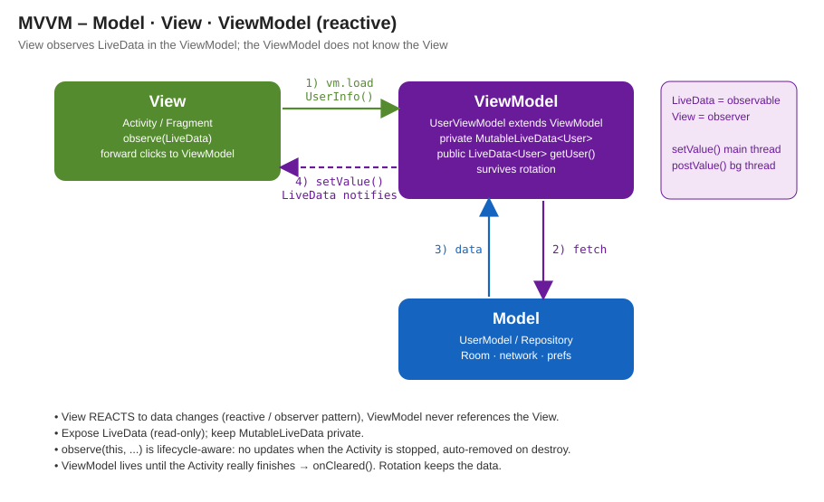
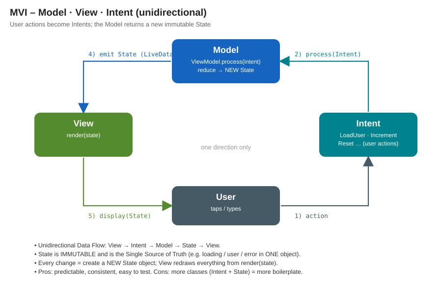

## 11. Templates
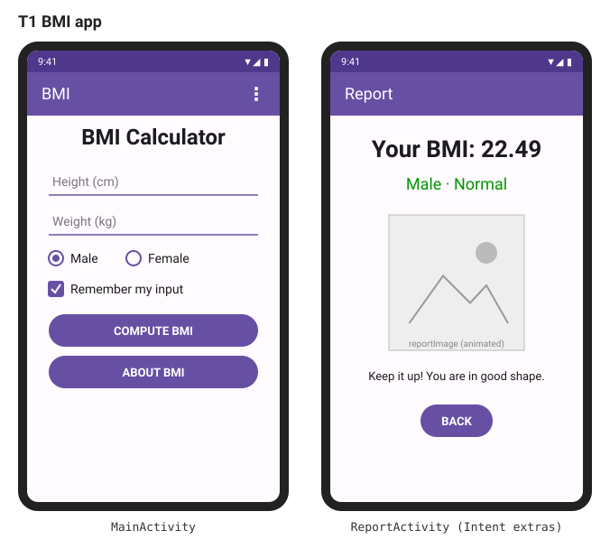
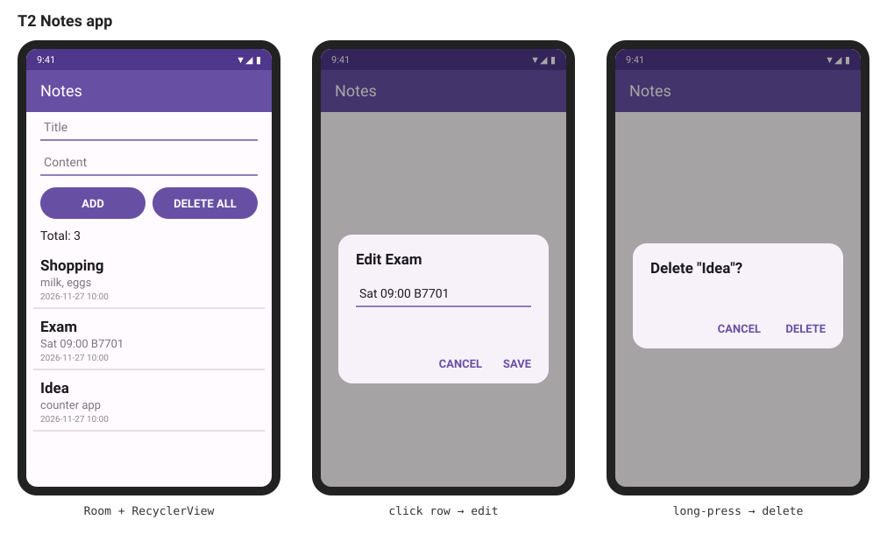

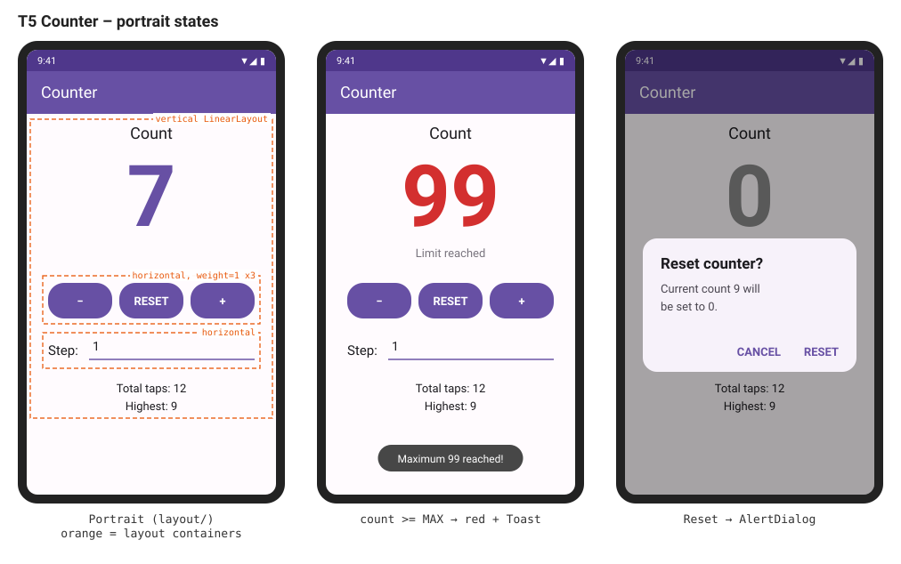
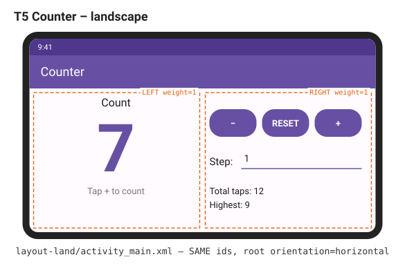
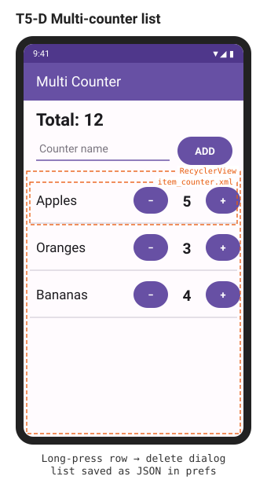
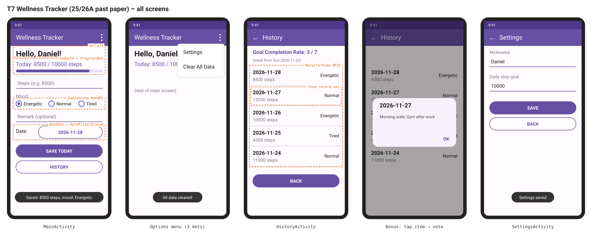

---
## 12. Layout change recipes
| Want | Do this |
|---|---|
| Row of buttons → column | inner LinearLayout `orientation="vertical"`, buttons `layout_width="match_parent"` (remove `0dp` + weight) |
| Column → row | `orientation="horizontal"`, children `layout_width="0dp"` + `layout_weight="1"` |
| Centre everything | root `android:gravity="center"` |
| Push a button to the bottom | spacer above it: `<View android:layout_width="match_parent" android:layout_height="0dp" android:layout_weight="1"/>` |
| Push an item to the right in a row | spacer before it: `<View android:layout_width="0dp" android:layout_height="1dp" android:layout_weight="1"/>` |
| One widget takes 2/3 of the width | weights `2` and `1`, both widths `0dp` |
| Space between widgets | `layout_marginTop="16dp"` / `layout_marginStart="8dp"` |
| Hide but keep the space / remove the space | `android:visibility="invisible"` / `"gone"` |
| Landscape = side by side | `layout-land/` copy, root `horizontal`, two children `0dp` + `weight=1` |
| Too tall in landscape | wrap the root in `<ScrollView>` (one child only) |
| Text centred inside its box | `android:gravity="center"` on the TextView |
| View centred in its parent | `android:layout_gravity="center"` (LinearLayout parent) or constrain all 4 sides (ConstraintLayout) |
| Big round number | `200dp` width and height, `gravity="center"`, `background="@drawable/circle"` |
| Change button colour | `app:backgroundTint="#D32F2F"` |
| Grid of buttons | `GridLayout columnCount="2"` or nested horizontal LinearLayouts |
