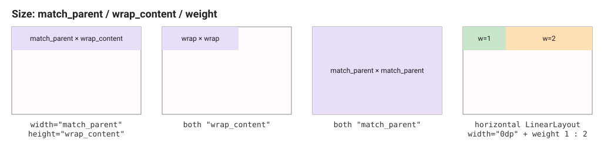
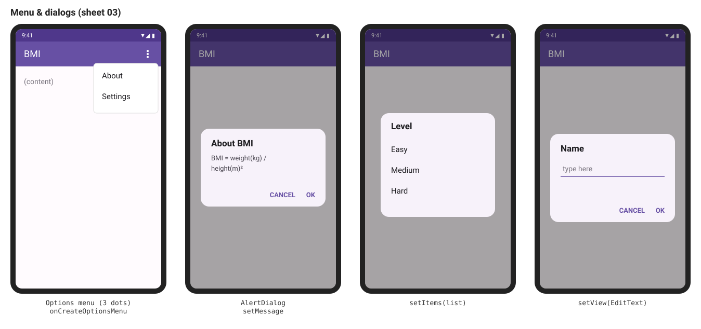
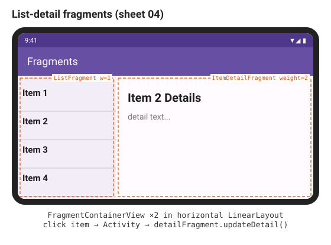
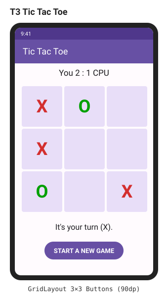
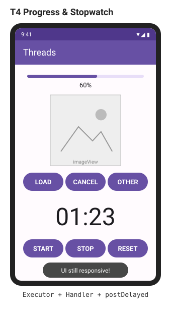

# 14 · Screen Gallery: What Each Layout Looks Like + How to Change It

[⬅ Index](../README.md)

Orange dashed boxes show the **layout containers**, so you can see which XML block to edit. Code for each screen is in the linked sheet or template.

## Contents
1. [Size: match_parent / wrap_content / weight](#1-size)
2. [padding vs margin](#2-padding-vs-margin)
3. [gravity vs layout_gravity](#3-gravity-vs-layout_gravity)
4. [Linear / Table / Grid layouts](#4-linear--table--grid)
5. [ConstraintLayout](#5-constraintlayout)
6. [Widget gallery](#6-widget-gallery)
7. [Menu & dialogs](#7-menu--dialogs)
8. [Fragments list-detail](#8-fragments)
9. [RecyclerView: list / grid / multi-type](#9-recyclerview)
10. [Counter app (T5): portrait, landscape, multi-counter](#10-counter-app-t5)
11. [Other templates T1–T4](#11-templates-t1t4)
12. [Layout change recipes](#12-layout-change-recipes)

---
## 1. Size

```xml
android:layout_width="match_parent"   <!-- fill parent -->
android:layout_width="wrap_content"   <!-- just big enough -->
android:layout_width="0dp" android:layout_weight="1"   <!-- share space (LinearLayout) -->
```

## 2. padding vs margin

```xml
android:layout_margin="16dp"   <!-- space OUTSIDE the view -->
android:padding="16dp"         <!-- space INSIDE, between border and content -->
```

## 3. gravity vs layout_gravity

```xml
<!-- on the PARENT / TextView: positions its children or its text -->
android:gravity="center"
<!-- on the CHILD (inside LinearLayout): positions itself -->
android:layout_gravity="center_horizontal"
```

## 4. Linear / Table / Grid

Code: [sheet 02](02-layouts-widgets.md#linearlayout-fastest-to-write) · [TableLayout](02-layouts-widgets.md#tablelayout) · [GridLayout](02-layouts-widgets.md#gridlayout-33-board-eg-tic-tac-toe)

## 5. ConstraintLayout

```xml
app:layout_constraintTop_toTopOf="parent"
app:layout_constraintStart_toStartOf="parent"
app:layout_constraintEnd_toEndOf="parent"          <!-- start + end = centred -->
app:layout_constraintTop_toBottomOf="@id/label"
app:layout_constraintHorizontal_bias="0.0"         <!-- 0 left · 0.5 centre · 1 right -->
```

## 6. Widget gallery

XML + Java for each widget: [sheet 02 Widgets](02-layouts-widgets.md#widgets-cheat-table-xml--java)

## 7. Menu & dialogs

Code: [sheet 03](03-activity-intent-lifecycle.md#alertdialog-about--confirm)

## 8. Fragments

Code: [sheet 04](04-fragments.md)

## 9. RecyclerView

Code: [sheet 09](09-recyclerview.md) · switch list → grid: `rv.setLayoutManager(new GridLayoutManager(this, 2));`

## 10. Counter app (T5)


Code: [T5 Counter app](../templates/T5-counter-app.md)

## 11. Templates T1–T4




Code: [T1](../templates/T1-bmi-two-activities.md) · [T2](../templates/T2-room-recyclerview-crud.md) · [T3](../templates/T3-tictactoe.md) · [T4](../templates/T4-progress-handler.md)

---
## 12. Layout change recipes
Use these when the question says "rearrange the screen" or "add a landscape layout".

| Want | Do this |
|---|---|
| Row of buttons → column | inner LinearLayout `orientation="vertical"`, buttons `layout_width="match_parent"` (remove `0dp`/weight) |
| Column → row | `orientation="horizontal"`, children `layout_width="0dp"` + `layout_weight="1"` |
| Centre everything | root `android:gravity="center"` |
| Push button to bottom | empty spacer above it: `<View android:layout_width="match_parent" android:layout_height="0dp" android:layout_weight="1"/>` |
| Push item to right in a row | spacer before it: `<View android:layout_width="0dp" android:layout_height="1dp" android:layout_weight="1"/>` |
| One widget takes 2/3 width | weights `2` and `1`, both width `0dp` |
| Space between widgets | `layout_marginTop="16dp"` / `layout_marginStart="8dp"` |
| Hide but keep space / remove space | `android:visibility="invisible"` / `"gone"` |
| Landscape = side by side | `layout-land/` copy, root `horizontal`, two children `0dp` + `weight=1` (see T5 landscape) |
| Too tall in landscape | wrap the root in `<ScrollView>` (it allows one child only) |
| Text centred inside its box | `android:gravity="center"` on the TextView |
| View centred in its parent | `android:layout_gravity="center"` (LinearLayout parent) or constrain all 4 sides to parent (ConstraintLayout) |
| Big round number display | `width/height="200dp"`, `gravity="center"`, `background="@drawable/circle"` (oval shape, sheet 11) |
| Change button colour (Material theme) | `app:backgroundTint="#D32F2F"` (needs `xmlns:app`) |
