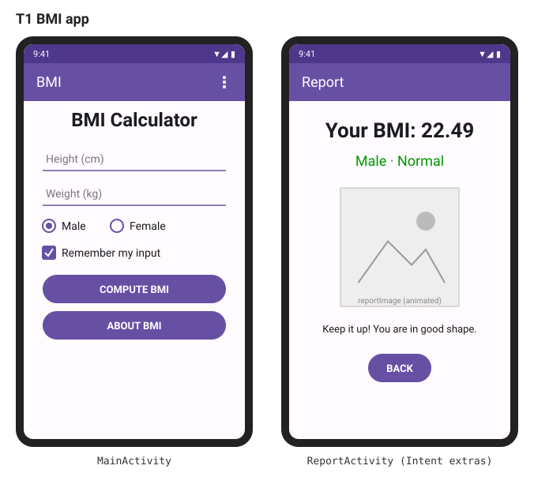

# T1 · BMI App: 2 Activities + SharedPreferences + Validation + Menu + Animation

[⬅ Index](../README.md)



## Files
```
MainActivity.java      activity_main.xml
ReportActivity.java    activity_report.xml
res/menu/main_menu.xml res/values/strings.xml
```

## strings.xml
```xml
<resources>
    <string name="app_name">BMI</string>
    <string name="advice_heavy">You should exercise more and eat less.</string>
    <string name="advice_light">You should eat more nutritious food.</string>
    <string name="advice_average">Keep it up! You are in good shape.</string>
    <string name="about_msg">BMI = weight (kg) / height (m)².\nNormal range: 18.5 – 24.9</string>
</resources>
```

## activity_main.xml
```xml
<?xml version="1.0" encoding="utf-8"?>
<ScrollView xmlns:android="http://schemas.android.com/apk/res/android"
    android:layout_width="match_parent" android:layout_height="match_parent">
<LinearLayout
    android:layout_width="match_parent" android:layout_height="wrap_content"
    android:orientation="vertical" android:padding="24dp">

    <TextView android:layout_width="wrap_content" android:layout_height="wrap_content"
        android:layout_gravity="center_horizontal" android:text="BMI Calculator"
        android:textSize="26sp" android:textStyle="bold" android:layout_marginBottom="16dp"/>

    <EditText android:id="@+id/heightET" android:layout_width="match_parent"
        android:layout_height="wrap_content" android:hint="Height (cm)" android:inputType="numberDecimal"/>

    <EditText android:id="@+id/weightET" android:layout_width="match_parent"
        android:layout_height="wrap_content" android:hint="Weight (kg)" android:inputType="numberDecimal"/>

    <RadioGroup android:id="@+id/genderRG" android:layout_width="wrap_content"
        android:layout_height="wrap_content" android:orientation="horizontal">
        <RadioButton android:id="@+id/maleRB" android:layout_width="wrap_content"
            android:layout_height="wrap_content" android:text="Male" android:checked="true"/>
        <RadioButton android:id="@+id/femaleRB" android:layout_width="wrap_content"
            android:layout_height="wrap_content" android:text="Female"/>
    </RadioGroup>

    <CheckBox android:id="@+id/rememberCB" android:layout_width="wrap_content"
        android:layout_height="wrap_content" android:text="Remember my input" android:checked="true"/>

    <Button android:id="@+id/reportBtn" android:layout_width="match_parent"
        android:layout_height="wrap_content" android:text="Compute BMI"/>

    <Button android:id="@+id/aboutBtn" android:layout_width="match_parent"
        android:layout_height="wrap_content" android:text="About BMI"/>
</LinearLayout>
</ScrollView>
```

## MainActivity.java
```java
package com.example.bmi;

import android.content.Intent;
import android.content.SharedPreferences;
import android.os.Bundle;
import android.view.Menu;
import android.view.MenuItem;
import android.widget.*;
import androidx.annotation.NonNull;
import androidx.appcompat.app.AlertDialog;
import androidx.appcompat.app.AppCompatActivity;

public class MainActivity extends AppCompatActivity {

    private EditText heightET, weightET;
    private RadioGroup genderRG;
    private CheckBox rememberCB;
    private static final String PREF = "BMI";

    @Override
    protected void onCreate(Bundle savedInstanceState) {
        super.onCreate(savedInstanceState);
        setContentView(R.layout.activity_main);

        heightET = findViewById(R.id.heightET);
        weightET = findViewById(R.id.weightET);
        genderRG = findViewById(R.id.genderRG);
        rememberCB = findViewById(R.id.rememberCB);

        findViewById(R.id.reportBtn).setOnClickListener(v -> openReport());
        findViewById(R.id.aboutBtn).setOnClickListener(v -> showAbout());

        loadPrefs();
    }

    private void openReport() {
        Double h = readDouble(heightET, "Height");
        Double w = readDouble(weightET, "Weight");
        if (h == null || w == null) return;

        String gender = genderRG.getCheckedRadioButtonId() == R.id.maleRB ? "Male" : "Female";

        Intent i = new Intent(this, ReportActivity.class);
        i.putExtra("HEIGHT", h);
        i.putExtra("WEIGHT", w);
        i.putExtra("GENDER", gender);
        startActivity(i);
    }

    private Double readDouble(EditText et, String name) {
        String s = et.getText().toString().trim();
        if (s.isEmpty()) { et.setError(name + " required"); return null; }
        try {
            double v = Double.parseDouble(s);
            if (v <= 0) { et.setError(name + " must be > 0"); return null; }
            return v;
        } catch (NumberFormatException e) { et.setError("Invalid number"); return null; }
    }

    private void showAbout() {
        new AlertDialog.Builder(this)
                .setTitle("About BMI")
                .setMessage(R.string.about_msg)
                .setPositiveButton("OK", null)
                .show();
    }

    // ---- SharedPreferences ----
    @Override
    protected void onPause() {
        super.onPause();
        SharedPreferences.Editor ed = getSharedPreferences(PREF, MODE_PRIVATE).edit();
        if (rememberCB.isChecked()) {
            ed.putString("height", heightET.getText().toString())
              .putString("weight", weightET.getText().toString());
        } else {
            ed.clear();
        }
        ed.putBoolean("remember", rememberCB.isChecked()).apply();
    }

    private void loadPrefs() {
        SharedPreferences p = getSharedPreferences(PREF, MODE_PRIVATE);
        heightET.setText(p.getString("height", ""));
        weightET.setText(p.getString("weight", ""));
        rememberCB.setChecked(p.getBoolean("remember", true));
    }

    // ---- Options menu ----
    @Override
    public boolean onCreateOptionsMenu(Menu menu) {
        getMenuInflater().inflate(R.menu.main_menu, menu);
        return true;
    }

    @Override
    public boolean onOptionsItemSelected(@NonNull MenuItem item) {
        if (item.getItemId() == R.id.action_about) { showAbout(); return true; }
        if (item.getItemId() == R.id.action_clear) {
            heightET.setText(""); weightET.setText(""); return true;
        }
        return super.onOptionsItemSelected(item);
    }
}
```

## res/menu/main_menu.xml
```xml
<menu xmlns:android="http://schemas.android.com/apk/res/android">
    <item android:id="@+id/action_about" android:title="About"/>
    <item android:id="@+id/action_clear" android:title="Clear"/>
</menu>
```

## activity_report.xml
```xml
<?xml version="1.0" encoding="utf-8"?>
<LinearLayout xmlns:android="http://schemas.android.com/apk/res/android"
    android:layout_width="match_parent" android:layout_height="match_parent"
    android:orientation="vertical" android:gravity="center_horizontal" android:padding="24dp">

    <TextView android:id="@+id/resultTV" android:layout_width="wrap_content"
        android:layout_height="wrap_content" android:textSize="28sp" android:textStyle="bold"/>

    <TextView android:id="@+id/categoryTV" android:layout_width="wrap_content"
        android:layout_height="wrap_content" android:textSize="20sp" android:layout_marginTop="8dp"/>

    <ImageView android:id="@+id/reportImage" android:layout_width="150dp"
        android:layout_height="150dp" android:layout_marginTop="24dp"
        android:src="@android:drawable/ic_dialog_info" android:contentDescription="bmi image"/>

    <TextView android:id="@+id/adviceTV" android:layout_width="wrap_content"
        android:layout_height="wrap_content" android:layout_marginTop="24dp" android:textSize="16sp"/>

    <Button android:id="@+id/backBtn" android:layout_width="wrap_content"
        android:layout_height="wrap_content" android:layout_marginTop="24dp" android:text="Back"/>
</LinearLayout>
```

## ReportActivity.java
```java
package com.example.bmi;

import android.graphics.Color;
import android.os.Bundle;
import android.widget.*;
import androidx.appcompat.app.AppCompatActivity;
import java.util.Locale;

public class ReportActivity extends AppCompatActivity {
    @Override
    protected void onCreate(Bundle savedInstanceState) {
        super.onCreate(savedInstanceState);
        setContentView(R.layout.activity_report);

        if (getSupportActionBar() != null) getSupportActionBar().setDisplayHomeAsUpEnabled(true);

        double h = getIntent().getDoubleExtra("HEIGHT", 0);
        double w = getIntent().getDoubleExtra("WEIGHT", 0);
        String gender = getIntent().getStringExtra("GENDER");

        double m = h / 100.0;
        double bmi = w / (m * m);

        TextView resultTV = findViewById(R.id.resultTV);
        TextView categoryTV = findViewById(R.id.categoryTV);
        TextView adviceTV = findViewById(R.id.adviceTV);
        ImageView image = findViewById(R.id.reportImage);

        resultTV.setText(String.format(Locale.US, "Your BMI: %.2f", bmi));

        if (bmi >= 25) {
            categoryTV.setText(gender + " · Overweight");
            categoryTV.setTextColor(Color.RED);
            adviceTV.setText(R.string.advice_heavy);
            image.animate().scaleX(1.5f).scaleY(1.5f).setDuration(2000);
        } else if (bmi < 18.5) {
            categoryTV.setText(gender + " · Underweight");
            categoryTV.setTextColor(Color.BLUE);
            adviceTV.setText(R.string.advice_light);
            image.animate().scaleX(0.6f).scaleY(0.6f).setDuration(2000);
        } else {
            categoryTV.setText(gender + " · Normal");
            categoryTV.setTextColor(Color.rgb(0, 150, 0));
            adviceTV.setText(R.string.advice_average);
            image.animate().rotation(360f).setDuration(2000);
        }

        findViewById(R.id.backBtn).setOnClickListener(v -> finish());
    }

    @Override
    public boolean onSupportNavigateUp() { finish(); return true; }
}
```

## Manifest addition
```xml
<activity android:name=".ReportActivity" android:parentActivityName=".MainActivity"/>
```

### Variations
- **Return a result to Main:** use `ActivityResultLauncher` (sheet 03).
- **History list of BMIs:** combine with T2 (Room + RecyclerView).
- **Landscape:** copy `activity_main.xml` into `layout-land/` with a horizontal root (sheet 14 recipes).
