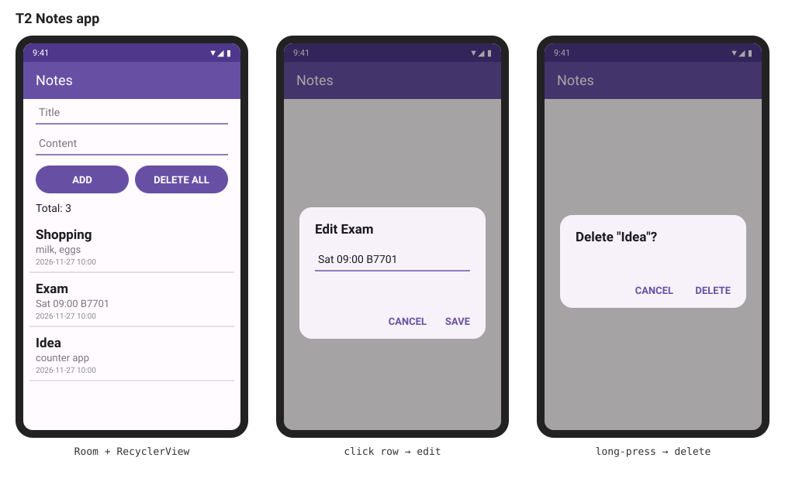

# T2 · Notes App: Room + RecyclerView + Add / Edit / Delete (Java)

[⬅ Index](../README.md)



## Gradle
```kotlin
implementation("androidx.recyclerview:recyclerview:1.3.2")
implementation("androidx.room:room-runtime:2.6.1")
annotationProcessor("androidx.room:room-compiler:2.6.1")
```

## Note.java
```java
@Entity(tableName = "notes")
public class Note {
    @PrimaryKey(autoGenerate = true) public int id;
    public String title;
    public String content;
    public long createdAt;
    public Note(String title, String content, long createdAt) {
        this.title = title; this.content = content; this.createdAt = createdAt;
    }
}
```

## NoteDao.java
```java
@Dao
public interface NoteDao {
    @Query("SELECT * FROM notes ORDER BY createdAt DESC") LiveData<List<Note>> getAll();
    @Insert void insert(Note n);
    @Update void update(Note n);
    @Delete void delete(Note n);
    @Query("DELETE FROM notes") void deleteAll();
}
```

## AppDatabase.java
```java
@Database(entities = {Note.class}, version = 1, exportSchema = false)
public abstract class AppDatabase extends RoomDatabase {
    public abstract NoteDao noteDao();
    private static volatile AppDatabase INSTANCE;
    public static AppDatabase getInstance(Context ctx) {
        if (INSTANCE == null) {
            synchronized (AppDatabase.class) {
                if (INSTANCE == null)
                    INSTANCE = Room.databaseBuilder(ctx.getApplicationContext(), AppDatabase.class, "notes_db")
                            .fallbackToDestructiveMigration().build();
            }
        }
        return INSTANCE;
    }
}
```

## item_note.xml
```xml
<?xml version="1.0" encoding="utf-8"?>
<LinearLayout xmlns:android="http://schemas.android.com/apk/res/android"
    android:layout_width="match_parent" android:layout_height="wrap_content"
    android:orientation="vertical" android:padding="12dp">
    <TextView android:id="@+id/titleTV" android:layout_width="match_parent"
        android:layout_height="wrap_content" android:textSize="18sp" android:textStyle="bold"/>
    <TextView android:id="@+id/contentTV" android:layout_width="match_parent"
        android:layout_height="wrap_content" android:maxLines="2" android:ellipsize="end"/>
    <TextView android:id="@+id/dateTV" android:layout_width="wrap_content"
        android:layout_height="wrap_content" android:textSize="12sp" android:textColor="#888888"/>
</LinearLayout>
```

## NoteAdapter.java
```java
public class NoteAdapter extends RecyclerView.Adapter<NoteAdapter.VH> {
    public interface Listener { void onClick(Note n); void onLongClick(Note n); }
    private final List<Note> data = new ArrayList<>();
    private final Listener listener;
    public NoteAdapter(Listener l) { listener = l; }

    public void setData(List<Note> list) { data.clear(); if (list != null) data.addAll(list); notifyDataSetChanged(); }

    static class VH extends RecyclerView.ViewHolder {
        TextView title, content, date;
        VH(View v) { super(v);
            title = v.findViewById(R.id.titleTV); content = v.findViewById(R.id.contentTV); date = v.findViewById(R.id.dateTV); }
    }
    @NonNull @Override public VH onCreateViewHolder(@NonNull ViewGroup p, int t) {
        return new VH(LayoutInflater.from(p.getContext()).inflate(R.layout.item_note, p, false));
    }
    @Override public void onBindViewHolder(@NonNull VH h, int pos) {
        Note n = data.get(pos);
        h.title.setText(n.title);
        h.content.setText(n.content);
        h.date.setText(DateFormat.format("yyyy-MM-dd HH:mm", n.createdAt));
        h.itemView.setOnClickListener(v -> listener.onClick(n));
        h.itemView.setOnLongClickListener(v -> { listener.onLongClick(n); return true; });
    }
    @Override public int getItemCount() { return data.size(); }
}
```

## activity_main.xml
```xml
<?xml version="1.0" encoding="utf-8"?>
<LinearLayout xmlns:android="http://schemas.android.com/apk/res/android"
    android:layout_width="match_parent" android:layout_height="match_parent"
    android:orientation="vertical" android:padding="16dp">
    <EditText android:id="@+id/titleET" android:layout_width="match_parent"
        android:layout_height="wrap_content" android:hint="Title"/>
    <EditText android:id="@+id/contentET" android:layout_width="match_parent"
        android:layout_height="wrap_content" android:hint="Content"/>
    <LinearLayout android:layout_width="match_parent" android:layout_height="wrap_content"
        android:orientation="horizontal">
        <Button android:id="@+id/addBtn" android:layout_width="0dp" android:layout_weight="1"
            android:layout_height="wrap_content" android:text="Add"/>
        <Button android:id="@+id/clearAllBtn" android:layout_width="0dp" android:layout_weight="1"
            android:layout_height="wrap_content" android:layout_marginStart="8dp" android:text="Delete All"/>
    </LinearLayout>
    <TextView android:id="@+id/countTV" android:layout_width="wrap_content"
        android:layout_height="wrap_content" android:layout_marginTop="8dp"/>
    <androidx.recyclerview.widget.RecyclerView android:id="@+id/rv"
        android:layout_width="match_parent" android:layout_height="0dp" android:layout_weight="1"/>
</LinearLayout>
```

## MainActivity.java
```java
public class MainActivity extends AppCompatActivity {
    private NoteDao dao;
    private final ExecutorService io = Executors.newSingleThreadExecutor();
    private EditText titleET, contentET;

    @Override
    protected void onCreate(Bundle savedInstanceState) {
        super.onCreate(savedInstanceState);
        setContentView(R.layout.activity_main);
        titleET = findViewById(R.id.titleET);
        contentET = findViewById(R.id.contentET);
        TextView countTV = findViewById(R.id.countTV);
        dao = AppDatabase.getInstance(this).noteDao();

        NoteAdapter adapter = new NoteAdapter(new NoteAdapter.Listener() {
            @Override public void onClick(Note n) { showEditDialog(n); }
            @Override public void onLongClick(Note n) { confirmDelete(n); }
        });
        RecyclerView rv = findViewById(R.id.rv);
        rv.setLayoutManager(new LinearLayoutManager(this));
        rv.addItemDecoration(new DividerItemDecoration(this, DividerItemDecoration.VERTICAL));
        rv.setAdapter(adapter);

        dao.getAll().observe(this, notes -> {            // auto-refresh
            adapter.setData(notes);
            countTV.setText("Total: " + notes.size());
        });

        findViewById(R.id.addBtn).setOnClickListener(v -> {
            String t = titleET.getText().toString().trim();
            if (t.isEmpty()) { titleET.setError("Required"); return; }
            Note n = new Note(t, contentET.getText().toString().trim(), System.currentTimeMillis());
            io.execute(() -> dao.insert(n));
            titleET.setText(""); contentET.setText("");
        });
        findViewById(R.id.clearAllBtn).setOnClickListener(v ->
            new AlertDialog.Builder(this).setTitle("Delete all?")
                .setPositiveButton("Yes", (d, w) -> io.execute(() -> dao.deleteAll()))
                .setNegativeButton("No", null).show());
    }

    private void confirmDelete(Note n) {
        new AlertDialog.Builder(this).setTitle("Delete \"" + n.title + "\"?")
            .setPositiveButton("Delete", (d, w) -> io.execute(() -> dao.delete(n)))
            .setNegativeButton("Cancel", null).show();
    }

    private void showEditDialog(Note n) {
        EditText et = new EditText(this);
        et.setText(n.content);
        new AlertDialog.Builder(this).setTitle("Edit " + n.title).setView(et)
            .setPositiveButton("Save", (d, w) -> { n.content = et.getText().toString(); io.execute(() -> dao.update(n)); })
            .setNegativeButton("Cancel", null).show();
    }

    @Override protected void onDestroy() { super.onDestroy(); io.shutdown(); }
}
```
