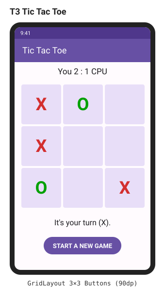

# T3 · Tic Tac Toe: Button Grid + Game Logic + Simple AI + Score

[⬅ Index](../README.md)



## activity_main.xml
```xml
<?xml version="1.0" encoding="utf-8"?>
<LinearLayout xmlns:android="http://schemas.android.com/apk/res/android"
    android:layout_width="match_parent" android:layout_height="match_parent"
    android:orientation="vertical" android:gravity="center_horizontal" android:padding="16dp">
    <TextView android:id="@+id/scoreTV" android:layout_width="wrap_content"
        android:layout_height="wrap_content" android:textSize="18sp" android:text="You 0 : 0 CPU"/>
    <GridLayout android:id="@+id/board" android:layout_width="wrap_content"
        android:layout_height="wrap_content" android:columnCount="3" android:rowCount="3"
        android:layout_marginTop="16dp">
        <Button android:id="@+id/b0" style="@style/Cell"/>
        <Button android:id="@+id/b1" style="@style/Cell"/>
        <Button android:id="@+id/b2" style="@style/Cell"/>
        <Button android:id="@+id/b3" style="@style/Cell"/>
        <Button android:id="@+id/b4" style="@style/Cell"/>
        <Button android:id="@+id/b5" style="@style/Cell"/>
        <Button android:id="@+id/b6" style="@style/Cell"/>
        <Button android:id="@+id/b7" style="@style/Cell"/>
        <Button android:id="@+id/b8" style="@style/Cell"/>
    </GridLayout>
    <TextView android:id="@+id/statusTV" android:layout_width="wrap_content"
        android:layout_height="wrap_content" android:layout_marginTop="16dp"
        android:textSize="18sp" android:text="It's your turn (X)."/>
    <Button android:id="@+id/newGameBtn" android:layout_width="wrap_content"
        android:layout_height="wrap_content" android:layout_marginTop="16dp" android:text="Start a new game"/>
</LinearLayout>
```

## res/values/styles.xml
```xml
<resources>
    <style name="Cell">
        <item name="android:layout_width">90dp</item>
        <item name="android:layout_height">90dp</item>
        <item name="android:layout_margin">4dp</item>
        <item name="android:textSize">36sp</item>
    </style>
</resources>
```

## MainActivity.java
```java
public class MainActivity extends AppCompatActivity {
    private static final char HUMAN = 'X', CPU = 'O', EMPTY = ' ';
    private static final int[][] LINES = {
        {0,1,2},{3,4,5},{6,7,8},{0,3,6},{1,4,7},{2,5,8},{0,4,8},{2,4,6}
    };
    private final Button[] cells = new Button[9];
    private char[] board = new char[9];
    private boolean gameOver = false;
    private int humanWins = 0, cpuWins = 0;
    private TextView statusTV, scoreTV;
    private final Random rnd = new Random();
    private final Handler handler = new Handler(Looper.getMainLooper());

    @Override
    protected void onCreate(Bundle savedInstanceState) {
        super.onCreate(savedInstanceState);
        setContentView(R.layout.activity_main);
        statusTV = findViewById(R.id.statusTV);
        scoreTV = findViewById(R.id.scoreTV);

        int[] ids = {R.id.b0, R.id.b1, R.id.b2, R.id.b3, R.id.b4, R.id.b5, R.id.b6, R.id.b7, R.id.b8};
        for (int i = 0; i < 9; i++) {
            final int idx = i;
            cells[i] = findViewById(ids[i]);
            cells[i].setOnClickListener(v -> onCellClick(idx));
        }
        findViewById(R.id.newGameBtn).setOnClickListener(v -> newGame());

        SharedPreferences p = getSharedPreferences("TTT", MODE_PRIVATE);
        humanWins = p.getInt("human", 0);
        cpuWins = p.getInt("cpu", 0);

        if (savedInstanceState != null) {
            board = savedInstanceState.getCharArray("BOARD");
            gameOver = savedInstanceState.getBoolean("OVER");
            statusTV.setText(savedInstanceState.getString("STATUS"));
            for (int i = 0; i < 9; i++) drawCell(i);
        } else newGame();
        updateScore();
    }

    private void newGame() {
        handler.removeCallbacksAndMessages(null);
        for (int i = 0; i < 9; i++) { board[i] = EMPTY; drawCell(i); cells[i].setEnabled(true); }
        gameOver = false;
        statusTV.setText("It's your turn (X).");
    }

    private void onCellClick(int i) {
        if (gameOver || board[i] != EMPTY) return;
        move(i, HUMAN);
        if (checkEnd()) return;
        statusTV.setText("Android's turn (O)...");
        setBoardEnabled(false);
        handler.postDelayed(() -> {
            move(computerMove(), CPU);
            setBoardEnabled(true);
            if (!checkEnd()) statusTV.setText("It's your turn (X).");
        }, 500);
    }

    private void move(int i, char p) { board[i] = p; drawCell(i); }
    private void drawCell(int i) {
        cells[i].setText(board[i] == EMPTY ? "" : String.valueOf(board[i]));
        cells[i].setTextColor(board[i] == HUMAN ? Color.RED : Color.rgb(0, 160, 0));
    }
    private void setBoardEnabled(boolean e) { for (Button b : cells) b.setEnabled(e); }

    /** 0 none, 1 tie, 2 X wins, 3 O wins */
    private int winner() {
        for (int[] l : LINES)
            if (board[l[0]] != EMPTY && board[l[0]] == board[l[1]] && board[l[1]] == board[l[2]])
                return board[l[0]] == HUMAN ? 2 : 3;
        for (char c : board) if (c == EMPTY) return 0;
        return 1;
    }

    private boolean checkEnd() {
        int w = winner();
        if (w == 0) return false;
        gameOver = true;
        if (w == 1) statusTV.setText("It's a tie!");
        else if (w == 2) { statusTV.setText("You won!"); humanWins++; }
        else { statusTV.setText("Android won!"); cpuWins++; }
        getSharedPreferences("TTT", MODE_PRIVATE).edit().putInt("human", humanWins).putInt("cpu", cpuWins).apply();
        updateScore();
        return true;
    }

    /** win if possible → block → centre → random */
    private int computerMove() {
        for (char p : new char[]{CPU, HUMAN}) {
            for (int i = 0; i < 9; i++) {
                if (board[i] == EMPTY) {
                    board[i] = p;
                    boolean wins = winner() == (p == HUMAN ? 2 : 3);
                    board[i] = EMPTY;
                    if (wins) return i;
                }
            }
        }
        if (board[4] == EMPTY) return 4;
        List<Integer> free = new ArrayList<>();
        for (int i = 0; i < 9; i++) if (board[i] == EMPTY) free.add(i);
        return free.get(rnd.nextInt(free.size()));
    }

    private void updateScore() { scoreTV.setText("You " + humanWins + " : " + cpuWins + " CPU"); }

    @Override protected void onSaveInstanceState(Bundle out) {
        super.onSaveInstanceState(out);
        out.putCharArray("BOARD", board);
        out.putBoolean("OVER", gameOver);
        out.putString("STATUS", statusTV.getText().toString());
    }
    @Override protected void onDestroy() { super.onDestroy(); handler.removeCallbacksAndMessages(null); }
}
```
**2-player mode:** replace the CPU move with a `char turn` that toggles between X and O on each click.
