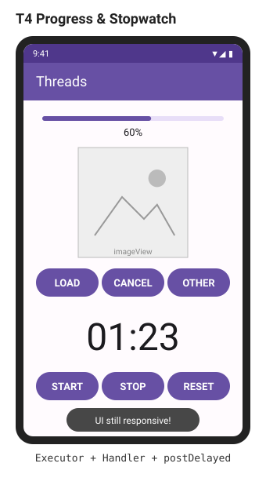

# T4 · Background Task + ProgressBar + Stopwatch (Executor/Handler)

[⬅ Index](../README.md)



## activity_main.xml
```xml
<?xml version="1.0" encoding="utf-8"?>
<LinearLayout xmlns:android="http://schemas.android.com/apk/res/android"
    android:layout_width="match_parent" android:layout_height="match_parent"
    android:orientation="vertical" android:padding="24dp" android:gravity="center_horizontal">
    <ProgressBar android:id="@+id/progressBar" style="?android:attr/progressBarStyleHorizontal"
        android:layout_width="match_parent" android:layout_height="wrap_content"
        android:max="100" android:visibility="invisible"/>
    <TextView android:id="@+id/percentTV" android:layout_width="wrap_content"
        android:layout_height="wrap_content" android:text="0%"/>
    <ImageView android:id="@+id/imageView" android:layout_width="200dp"
        android:layout_height="200dp" android:layout_marginTop="12dp" android:contentDescription="img"/>
    <LinearLayout android:layout_width="match_parent" android:layout_height="wrap_content" android:orientation="horizontal">
        <Button android:id="@+id/loadBtn" android:layout_width="0dp" android:layout_weight="1" android:layout_height="wrap_content" android:text="Load"/>
        <Button android:id="@+id/cancelBtn" android:layout_width="0dp" android:layout_weight="1" android:layout_height="wrap_content" android:text="Cancel"/>
        <Button android:id="@+id/otherBtn" android:layout_width="0dp" android:layout_weight="1" android:layout_height="wrap_content" android:text="Other"/>
    </LinearLayout>
    <TextView android:id="@+id/timeTV" android:layout_width="wrap_content"
        android:layout_height="wrap_content" android:layout_marginTop="32dp" android:textSize="48sp" android:text="00:00"/>
    <LinearLayout android:layout_width="match_parent" android:layout_height="wrap_content" android:orientation="horizontal">
        <Button android:id="@+id/startBtn" android:layout_width="0dp" android:layout_weight="1" android:layout_height="wrap_content" android:text="Start"/>
        <Button android:id="@+id/stopBtn" android:layout_width="0dp" android:layout_weight="1" android:layout_height="wrap_content" android:text="Stop"/>
        <Button android:id="@+id/resetBtn" android:layout_width="0dp" android:layout_weight="1" android:layout_height="wrap_content" android:text="Reset"/>
    </LinearLayout>
</LinearLayout>
```

## MainActivity.java
```java
public class MainActivity extends AppCompatActivity {
    private final ExecutorService executor = Executors.newSingleThreadExecutor();
    private final Handler main = new Handler(Looper.getMainLooper());
    private Future<?> task;
    private ProgressBar progressBar;
    private TextView percentTV, timeTV;
    private ImageView imageView;

    private int seconds = 0;
    private boolean running = false;
    private final Runnable tick = new Runnable() {
        @Override public void run() { seconds++; showTime(); main.postDelayed(this, 1000); }
    };

    @Override
    protected void onCreate(Bundle savedInstanceState) {
        super.onCreate(savedInstanceState);
        setContentView(R.layout.activity_main);
        progressBar = findViewById(R.id.progressBar);
        percentTV = findViewById(R.id.percentTV);
        imageView = findViewById(R.id.imageView);
        timeTV = findViewById(R.id.timeTV);

        findViewById(R.id.loadBtn).setOnClickListener(v -> startLoad());
        findViewById(R.id.cancelBtn).setOnClickListener(v -> { if (task != null) task.cancel(true); });
        findViewById(R.id.otherBtn).setOnClickListener(v -> Toast.makeText(this, "UI still responsive!", Toast.LENGTH_SHORT).show());
        findViewById(R.id.startBtn).setOnClickListener(v -> { if (!running) { running = true; main.postDelayed(tick, 1000); } });
        findViewById(R.id.stopBtn).setOnClickListener(v -> { running = false; main.removeCallbacks(tick); });
        findViewById(R.id.resetBtn).setOnClickListener(v -> { running = false; main.removeCallbacks(tick); seconds = 0; showTime(); });

        if (savedInstanceState != null) {
            seconds = savedInstanceState.getInt("SEC");
            running = savedInstanceState.getBoolean("RUN");
            if (running) main.postDelayed(tick, 1000);
        }
        showTime();
    }

    private void startLoad() {
        if (task != null && !task.isDone()) return;
        progressBar.setProgress(0);
        progressBar.setVisibility(View.VISIBLE);
        imageView.setImageDrawable(null);
        task = executor.submit(() -> {
            for (int i = 1; i <= 10; i++) {
                try { Thread.sleep(500); }
                catch (InterruptedException e) {
                    main.post(() -> { progressBar.setVisibility(View.INVISIBLE); percentTV.setText("Cancelled"); });
                    return;
                }
                final int p = i * 10;
                main.post(() -> { progressBar.setProgress(p); percentTV.setText(p + "%"); });
            }
            main.post(() -> {
                imageView.setImageResource(android.R.drawable.ic_dialog_info);
                progressBar.setVisibility(View.INVISIBLE);
                percentTV.setText("Done");
            });
        });
    }

    private void showTime() { timeTV.setText(String.format(Locale.US, "%02d:%02d", seconds / 60, seconds % 60)); }

    @Override protected void onSaveInstanceState(Bundle out) {
        super.onSaveInstanceState(out);
        out.putInt("SEC", seconds); out.putBoolean("RUN", running);
    }
    @Override protected void onDestroy() {
        super.onDestroy();
        main.removeCallbacksAndMessages(null);
        executor.shutdownNow();
    }
}
```
