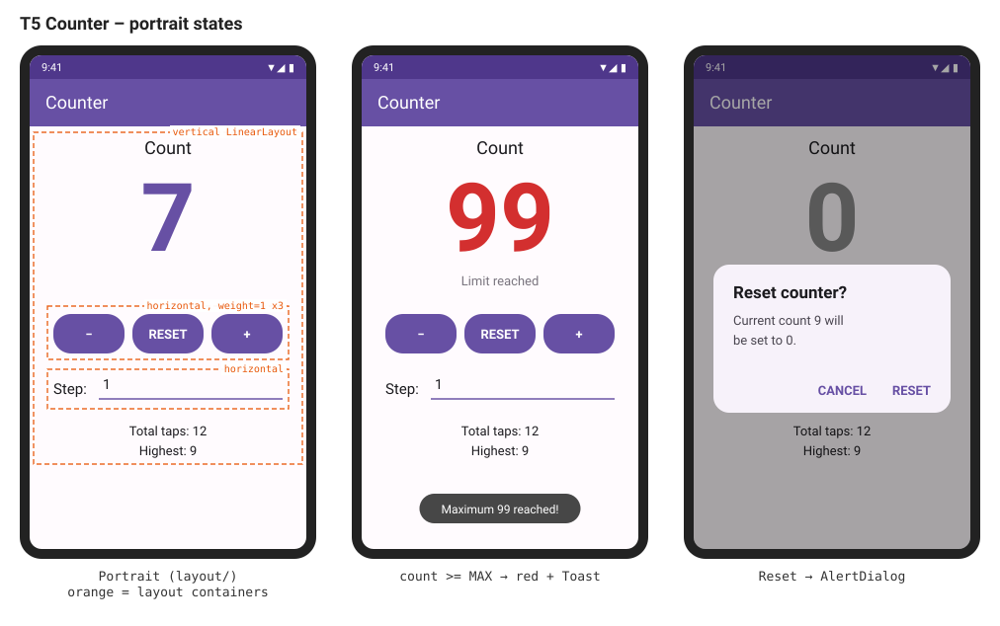
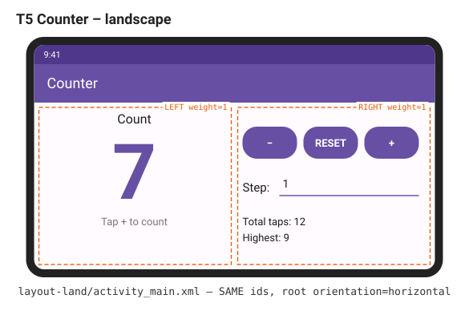
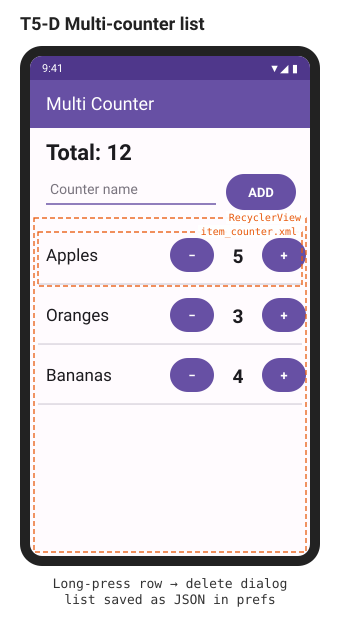

# T5 · Counter App: +/−/Reset, Step, Limit, Saved Count, Landscape, Multi-Counter List

[⬅ Index](../README.md) · Same app in MVP/MVVM/MVI: [T6](T6-architecture-counter.md)




**Features:**
- **+ / −** change the count by the step value. Tapping the number adds 1; long-pressing **+** adds 10.
- Range is 0–99. At the limit the number turns red and a Toast appears.
- Reset asks for confirmation.
- Tracks total taps and the highest value.
- Saved in SharedPreferences.
- Landscape layout with the same IDs.

## A. res/layout/activity_main.xml (portrait)
```xml
<?xml version="1.0" encoding="utf-8"?>
<LinearLayout xmlns:android="http://schemas.android.com/apk/res/android"
    android:id="@+id/main"
    android:layout_width="match_parent"
    android:layout_height="match_parent"
    android:orientation="vertical"
    android:gravity="center_horizontal"
    android:padding="24dp">

    <TextView android:layout_width="wrap_content" android:layout_height="wrap_content"
        android:layout_marginTop="16dp" android:text="Count" android:textSize="20sp" />

    <TextView android:id="@+id/countTV" android:layout_width="wrap_content"
        android:layout_height="wrap_content" android:text="0" android:textSize="96sp" android:textStyle="bold" />

    <TextView android:id="@+id/msgTV" android:layout_width="wrap_content"
        android:layout_height="wrap_content" android:text="Tap + to count" android:textColor="#79747E" />

    <LinearLayout android:layout_width="match_parent" android:layout_height="wrap_content"
        android:layout_marginTop="24dp" android:orientation="horizontal">
        <Button android:id="@+id/minusBtn" android:layout_width="0dp" android:layout_height="wrap_content"
            android:layout_weight="1" android:text="−" android:textSize="24sp" />
        <Button android:id="@+id/resetBtn" android:layout_width="0dp" android:layout_height="wrap_content"
            android:layout_weight="1" android:layout_marginStart="8dp" android:layout_marginEnd="8dp" android:text="Reset" />
        <Button android:id="@+id/plusBtn" android:layout_width="0dp" android:layout_height="wrap_content"
            android:layout_weight="1" android:text="+" android:textSize="24sp" />
    </LinearLayout>

    <LinearLayout android:layout_width="match_parent" android:layout_height="wrap_content"
        android:layout_marginTop="16dp" android:gravity="center_vertical" android:orientation="horizontal">
        <TextView android:layout_width="wrap_content" android:layout_height="wrap_content"
            android:text="Step:" android:textSize="16sp" />
        <EditText android:id="@+id/stepET" android:layout_width="0dp" android:layout_height="wrap_content"
            android:layout_weight="1" android:layout_marginStart="8dp" android:inputType="number" android:text="1" />
    </LinearLayout>

    <TextView android:id="@+id/totalTV" android:layout_width="wrap_content"
        android:layout_height="wrap_content" android:layout_marginTop="16dp" android:text="Total taps: 0" />
    <TextView android:id="@+id/bestTV" android:layout_width="wrap_content"
        android:layout_height="wrap_content" android:text="Highest: 0" />
</LinearLayout>
```

## res/layout-land/activity_main.xml (same IDs)
```xml
<?xml version="1.0" encoding="utf-8"?>
<LinearLayout xmlns:android="http://schemas.android.com/apk/res/android"
    android:id="@+id/main"
    android:layout_width="match_parent"
    android:layout_height="match_parent"
    android:orientation="horizontal"
    android:padding="16dp">

    <LinearLayout android:layout_width="0dp" android:layout_height="match_parent"
        android:layout_weight="1" android:gravity="center" android:orientation="vertical">
        <TextView android:id="@+id/countTV" android:layout_width="wrap_content" android:layout_height="wrap_content"
            android:text="0" android:textSize="96sp" android:textStyle="bold" />
        <TextView android:id="@+id/msgTV" android:layout_width="wrap_content" android:layout_height="wrap_content"
            android:text="Tap + to count" android:textColor="#79747E" />
    </LinearLayout>

    <LinearLayout android:layout_width="0dp" android:layout_height="match_parent"
        android:layout_weight="1" android:gravity="center_vertical" android:orientation="vertical">
        <LinearLayout android:layout_width="match_parent" android:layout_height="wrap_content" android:orientation="horizontal">
            <Button android:id="@+id/minusBtn" android:layout_width="0dp" android:layout_height="wrap_content"
                android:layout_weight="1" android:text="−" android:textSize="24sp" />
            <Button android:id="@+id/resetBtn" android:layout_width="0dp" android:layout_height="wrap_content"
                android:layout_weight="1" android:layout_marginStart="8dp" android:layout_marginEnd="8dp" android:text="Reset" />
            <Button android:id="@+id/plusBtn" android:layout_width="0dp" android:layout_height="wrap_content"
                android:layout_weight="1" android:text="+" android:textSize="24sp" />
        </LinearLayout>
        <LinearLayout android:layout_width="match_parent" android:layout_height="wrap_content"
            android:gravity="center_vertical" android:orientation="horizontal">
            <TextView android:layout_width="wrap_content" android:layout_height="wrap_content" android:text="Step:" />
            <EditText android:id="@+id/stepET" android:layout_width="0dp" android:layout_height="wrap_content"
                android:layout_weight="1" android:layout_marginStart="8dp" android:inputType="number" android:text="1" />
        </LinearLayout>
        <TextView android:id="@+id/totalTV" android:layout_width="wrap_content" android:layout_height="wrap_content" android:text="Total taps: 0" />
        <TextView android:id="@+id/bestTV" android:layout_width="wrap_content" android:layout_height="wrap_content" android:text="Highest: 0" />
    </LinearLayout>
</LinearLayout>
```

## MainActivity.java
```java
public class MainActivity extends AppCompatActivity {
    private static final int MIN = 0, MAX = 99;
    private static final String PREF = "COUNTER";
    private int count = 0, taps = 0, best = 0;
    private TextView countTV, msgTV, totalTV, bestTV;
    private EditText stepET;

    @Override
    protected void onCreate(Bundle savedInstanceState) {
        super.onCreate(savedInstanceState);
        setContentView(R.layout.activity_main);
        countTV = findViewById(R.id.countTV);
        msgTV = findViewById(R.id.msgTV);
        totalTV = findViewById(R.id.totalTV);
        bestTV = findViewById(R.id.bestTV);
        stepET = findViewById(R.id.stepET);
        Button plusBtn = findViewById(R.id.plusBtn);

        SharedPreferences p = getSharedPreferences(PREF, MODE_PRIVATE);
        count = p.getInt("count", 0);
        taps = p.getInt("taps", 0);
        best = p.getInt("best", 0);

        plusBtn.setOnClickListener(v -> change(+getStep()));
        findViewById(R.id.minusBtn).setOnClickListener(v -> change(-getStep()));
        countTV.setOnClickListener(v -> change(+1));
        plusBtn.setOnLongClickListener(v -> { change(+10); return true; });
        findViewById(R.id.resetBtn).setOnClickListener(v -> new AlertDialog.Builder(this)
                .setTitle("Reset counter?")
                .setMessage("Current count " + count + " will be set to 0.")
                .setPositiveButton("Reset", (d, w) -> { count = 0; updateUI(); })
                .setNegativeButton("Cancel", null).show());
        updateUI();
    }

    private int getStep() {
        try {
            int step = Integer.parseInt(stepET.getText().toString().trim());
            if (step <= 0) throw new NumberFormatException();
            return step;
        } catch (NumberFormatException e) {
            stepET.setError("Step must be a positive number");
            stepET.setText("1");
            return 1;
        }
    }

    private void change(int delta) {
        int next = count + delta;
        if (next > MAX) { next = MAX; Toast.makeText(this, "Maximum " + MAX + " reached!", Toast.LENGTH_SHORT).show(); }
        else if (next < MIN) { next = MIN; Toast.makeText(this, "Cannot go below " + MIN, Toast.LENGTH_SHORT).show(); }
        count = next;
        taps++;
        if (count > best) best = count;
        updateUI();
        countTV.animate().scaleX(1.3f).scaleY(1.3f).setDuration(100)
               .withEndAction(() -> countTV.animate().scaleX(1f).scaleY(1f).setDuration(100));
    }

    private void updateUI() {
        countTV.setText(String.valueOf(count));
        totalTV.setText("Total taps: " + taps);
        bestTV.setText("Highest: " + best);
        if (count >= MAX) { countTV.setTextColor(Color.RED); msgTV.setText("Limit reached"); }
        else if (count == MIN) { countTV.setTextColor(Color.GRAY); msgTV.setText("Tap + to count"); }
        else { countTV.setTextColor(Color.parseColor("#6750A4")); msgTV.setText(count % 10 == 0 ? "Nice, a multiple of 10!" : ""); }
    }

    @Override
    protected void onPause() {
        super.onPause();
        getSharedPreferences(PREF, MODE_PRIVATE).edit()
                .putInt("count", count).putInt("taps", taps).putInt("best", best).apply();
    }
}
```
If the count only needs to survive rotation (not an app restart), replace the prefs code with `onSaveInstanceState` (sheet 03).

## B. Multi-counter list (RecyclerView)


### Counter.java
```java
public class Counter {
    public String name; public int count;
    public Counter(String name, int count) { this.name = name; this.count = count; }
}
```

### res/layout/item_counter.xml
```xml
<?xml version="1.0" encoding="utf-8"?>
<LinearLayout xmlns:android="http://schemas.android.com/apk/res/android"
    android:layout_width="match_parent" android:layout_height="wrap_content"
    android:gravity="center_vertical" android:orientation="horizontal" android:padding="8dp">
    <TextView android:id="@+id/nameTV" android:layout_width="0dp" android:layout_height="wrap_content"
        android:layout_weight="1" android:textSize="18sp" />
    <Button android:id="@+id/minusBtn" android:layout_width="56dp" android:layout_height="wrap_content" android:text="−" />
    <TextView android:id="@+id/countTV" android:layout_width="48dp" android:layout_height="wrap_content"
        android:gravity="center" android:textSize="20sp" android:textStyle="bold" />
    <Button android:id="@+id/plusBtn" android:layout_width="56dp" android:layout_height="wrap_content" android:text="+" />
</LinearLayout>
```

### res/layout/activity_multi.xml
```xml
<?xml version="1.0" encoding="utf-8"?>
<LinearLayout xmlns:android="http://schemas.android.com/apk/res/android"
    android:layout_width="match_parent" android:layout_height="match_parent"
    android:orientation="vertical" android:padding="16dp">
    <TextView android:id="@+id/totalTV" android:layout_width="wrap_content" android:layout_height="wrap_content"
        android:text="Total: 0" android:textSize="22sp" android:textStyle="bold" />
    <LinearLayout android:layout_width="match_parent" android:layout_height="wrap_content" android:orientation="horizontal">
        <EditText android:id="@+id/nameET" android:layout_width="0dp" android:layout_height="wrap_content"
            android:layout_weight="1" android:hint="Counter name" />
        <Button android:id="@+id/addBtn" android:layout_width="wrap_content" android:layout_height="wrap_content" android:text="Add" />
    </LinearLayout>
    <androidx.recyclerview.widget.RecyclerView android:id="@+id/rv" android:layout_width="match_parent"
        android:layout_height="0dp" android:layout_weight="1" />
</LinearLayout>
```

### CounterAdapter.java
```java
public class CounterAdapter extends RecyclerView.Adapter<CounterAdapter.VH> {
    public interface Listener { void onCountChanged(); void onDelete(int position); }
    private final List<Counter> data;
    private final Listener listener;
    public CounterAdapter(List<Counter> data, Listener listener) { this.data = data; this.listener = listener; }

    static class VH extends RecyclerView.ViewHolder {
        TextView name, count; Button plus, minus;
        VH(View v) { super(v);
            name = v.findViewById(R.id.nameTV); count = v.findViewById(R.id.countTV);
            plus = v.findViewById(R.id.plusBtn); minus = v.findViewById(R.id.minusBtn); }
    }
    @NonNull @Override public VH onCreateViewHolder(@NonNull ViewGroup parent, int viewType) {
        return new VH(LayoutInflater.from(parent.getContext()).inflate(R.layout.item_counter, parent, false));
    }
    @Override public void onBindViewHolder(@NonNull VH h, int position) {
        Counter c = data.get(position);
        h.name.setText(c.name);
        h.count.setText(String.valueOf(c.count));
        h.plus.setOnClickListener(v -> {
            int p = h.getAdapterPosition(); if (p == RecyclerView.NO_POSITION) return;
            data.get(p).count++; notifyItemChanged(p); listener.onCountChanged();
        });
        h.minus.setOnClickListener(v -> {
            int p = h.getAdapterPosition(); if (p == RecyclerView.NO_POSITION || data.get(p).count == 0) return;
            data.get(p).count--; notifyItemChanged(p); listener.onCountChanged();
        });
        h.itemView.setOnLongClickListener(v -> { listener.onDelete(h.getAdapterPosition()); return true; });
    }
    @Override public int getItemCount() { return data.size(); }
}
```

### MultiCounterActivity.java
```java
public class MultiCounterActivity extends AppCompatActivity {
    private final List<Counter> counters = new ArrayList<>();
    private CounterAdapter adapter;
    private TextView totalTV;

    @Override
    protected void onCreate(Bundle savedInstanceState) {
        super.onCreate(savedInstanceState);
        setContentView(R.layout.activity_multi);
        totalTV = findViewById(R.id.totalTV);
        EditText nameET = findViewById(R.id.nameET);
        RecyclerView rv = findViewById(R.id.rv);
        load();

        adapter = new CounterAdapter(counters, new CounterAdapter.Listener() {
            @Override public void onCountChanged() { updateTotal(); }
            @Override public void onDelete(int pos) {
                if (pos == RecyclerView.NO_POSITION) return;
                new AlertDialog.Builder(MultiCounterActivity.this)
                    .setTitle("Delete " + counters.get(pos).name + "?")
                    .setPositiveButton("Delete", (d, w) -> { counters.remove(pos); adapter.notifyItemRemoved(pos); updateTotal(); })
                    .setNegativeButton("Cancel", null).show();
            }
        });
        rv.setLayoutManager(new LinearLayoutManager(this));
        rv.addItemDecoration(new DividerItemDecoration(this, DividerItemDecoration.VERTICAL));
        rv.setAdapter(adapter);

        findViewById(R.id.addBtn).setOnClickListener(v -> {
            String name = nameET.getText().toString().trim();
            if (name.isEmpty()) { nameET.setError("Enter a name"); return; }
            counters.add(new Counter(name, 0));
            adapter.notifyItemInserted(counters.size() - 1);
            nameET.setText("");
            updateTotal();
        });
        updateTotal();
    }

    private void updateTotal() {
        int sum = 0;
        for (Counter c : counters) sum += c.count;
        totalTV.setText("Total: " + sum);
    }

    @Override protected void onPause() {
        super.onPause();
        JSONArray arr = new JSONArray();
        try {
            for (Counter c : counters) {
                JSONObject o = new JSONObject();
                o.put("name", c.name); o.put("count", c.count);
                arr.put(o);
            }
        } catch (JSONException e) { e.printStackTrace(); }
        getSharedPreferences("MULTI", MODE_PRIVATE).edit().putString("list", arr.toString()).apply();
    }

    private void load() {
        String json = getSharedPreferences("MULTI", MODE_PRIVATE).getString("list", null);
        if (json == null) { counters.add(new Counter("Apples", 0)); counters.add(new Counter("Oranges", 0)); return; }
        try {
            JSONArray arr = new JSONArray(json);
            for (int i = 0; i < arr.length(); i++) {
                JSONObject o = arr.getJSONObject(i);
                counters.add(new Counter(o.getString("name"), o.getInt("count")));
            }
        } catch (JSONException e) { e.printStackTrace(); }
    }
}
```
Add to the manifest: `<activity android:name=".MultiCounterActivity" />`
