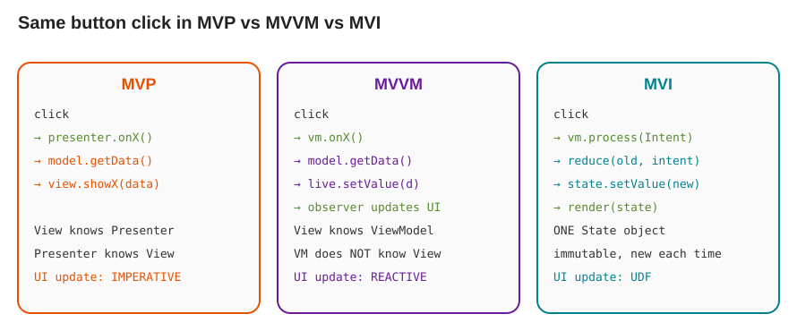

# T6 · One Counter App, Four Ways: Plain → MVP → MVVM → MVI (Java)

[⬅ Index](../README.md) · Theory + diagrams: [sheet 05](../sheets/05-architecture-mvvm.md) · Counter UI picture: [T5](T5-counter-app.md)

The same app in every version:
- **+** adds 1 and **−** subtracts 1, within the range **0–99**.
- **Reset** sets the count to 0.
- At 99 the number turns **red** and the message reads "Max reached". At 0 the message reads "Minimum".

Compare the versions to see **where the logic moves**. The layout is identical for all four.



---
## Shared layout `activity_main.xml`
```xml
<?xml version="1.0" encoding="utf-8"?>
<LinearLayout xmlns:android="http://schemas.android.com/apk/res/android"
    android:layout_width="match_parent"
    android:layout_height="match_parent"
    android:gravity="center"
    android:orientation="vertical"
    android:padding="24dp">

    <TextView
        android:id="@+id/countTV"
        android:layout_width="wrap_content"
        android:layout_height="wrap_content"
        android:text="0"
        android:textSize="96sp"
        android:textStyle="bold" />

    <TextView
        android:id="@+id/msgTV"
        android:layout_width="wrap_content"
        android:layout_height="wrap_content"
        android:text="" />

    <LinearLayout
        android:layout_width="match_parent"
        android:layout_height="wrap_content"
        android:layout_marginTop="24dp"
        android:orientation="horizontal">

        <Button
            android:id="@+id/minusBtn"
            android:layout_width="0dp"
            android:layout_height="wrap_content"
            android:layout_weight="1"
            android:text="−" />

        <Button
            android:id="@+id/resetBtn"
            android:layout_width="0dp"
            android:layout_height="wrap_content"
            android:layout_weight="1"
            android:layout_marginStart="8dp"
            android:layout_marginEnd="8dp"
            android:text="Reset" />

        <Button
            android:id="@+id/plusBtn"
            android:layout_width="0dp"
            android:layout_height="wrap_content"
            android:layout_weight="1"
            android:text="+" />
    </LinearLayout>
</LinearLayout>
```

## Shared Model `CounterModel.java` (MVP / MVVM / MVI all use it)
```java
package com.example.counter;

/** Model: pure data + business rules. No Android imports. */
public class CounterModel {
    public static final int MIN = 0;
    public static final int MAX = 99;

    private int count = 0;

    public int getCount() { return count; }

    public int increment() { if (count < MAX) count++; return count; }
    public int decrement() { if (count > MIN) count--; return count; }
    public int reset()     { count = 0; return count; }

    public boolean isMax() { return count >= MAX; }
    public boolean isMin() { return count <= MIN; }

    public String message() {
        if (isMax()) return "Max reached";
        if (isMin()) return "Minimum";
        return "";
    }
}
```

---
## 0. Plain "God Activity" (no architecture, for contrast)
```java
public class MainActivity extends AppCompatActivity {
    private int count = 0;                       // data in Activity ❌
    private TextView countTV, msgTV;

    @Override protected void onCreate(Bundle s) {
        super.onCreate(s);
        setContentView(R.layout.activity_main);
        countTV = findViewById(R.id.countTV);
        msgTV = findViewById(R.id.msgTV);
        findViewById(R.id.plusBtn).setOnClickListener(v -> { if (count < 99) count++; update(); }); // rules in Activity ❌
        findViewById(R.id.minusBtn).setOnClickListener(v -> { if (count > 0) count--; update(); });
        findViewById(R.id.resetBtn).setOnClickListener(v -> { count = 0; update(); });
        update();
    }
    private void update() {
        countTV.setText(String.valueOf(count));
        countTV.setTextColor(count >= 99 ? Color.RED : Color.BLACK);
        msgTV.setText(count >= 99 ? "Max reached" : count <= 0 ? "Minimum" : "");
    }
}
// Rotation → count resets to 0 ❌
```

---
## 1. MVP version
**Files:** `CounterModel.java`, `CounterView.java`, `CounterPresenter.java`, `MainActivity.java`

### CounterView.java (View interface)
```java
package com.example.counter;

public interface CounterView {
    void showCount(int count);
    void showMessage(String message);
    void showMaxWarning(boolean isMax);   // view decides HOW (red colour), presenter decides WHEN
}
```

### CounterPresenter.java
```java
package com.example.counter;

/** Presenter: holds View + Model, contains the logic, tells the View what to show. */
public class CounterPresenter {
    private CounterView view;
    private final CounterModel model;

    public CounterPresenter(CounterView view) {
        this.view = view;
        this.model = new CounterModel();
    }

    public void onPlusClicked()  { model.increment(); updateView(); }
    public void onMinusClicked() { model.decrement(); updateView(); }
    public void onResetClicked() { model.reset();     updateView(); }
    public void onStart()        { updateView(); }      // first draw

    private void updateView() {
        if (view == null) return;
        view.showCount(model.getCount());
        view.showMessage(model.message());
        view.showMaxWarning(model.isMax());
    }

    public void detachView() { view = null; }
}
```

### MainActivity.java (View implementation)
```java
package com.example.counter;

import android.graphics.Color;
import android.os.Bundle;
import android.widget.TextView;
import androidx.appcompat.app.AppCompatActivity;

public class MainActivity extends AppCompatActivity implements CounterView {

    private CounterPresenter presenter;
    private TextView countTV, msgTV;

    @Override
    protected void onCreate(Bundle savedInstanceState) {
        super.onCreate(savedInstanceState);
        setContentView(R.layout.activity_main);

        countTV = findViewById(R.id.countTV);
        msgTV   = findViewById(R.id.msgTV);

        presenter = new CounterPresenter(this);

        // View only FORWARDS user actions
        findViewById(R.id.plusBtn).setOnClickListener(v -> presenter.onPlusClicked());
        findViewById(R.id.minusBtn).setOnClickListener(v -> presenter.onMinusClicked());
        findViewById(R.id.resetBtn).setOnClickListener(v -> presenter.onResetClicked());

        presenter.onStart();
    }

    // Presenter calls these (imperative UI update)
    @Override public void showCount(int count)      { countTV.setText(String.valueOf(count)); }
    @Override public void showMessage(String msg)   { msgTV.setText(msg); }
    @Override public void showMaxWarning(boolean m) { countTV.setTextColor(m ? Color.RED : Color.BLACK); }

    @Override protected void onDestroy() {
        presenter.detachView();
        super.onDestroy();
    }
}
```
> ⚠️ In MVP the count is **lost on rotation**, because the Presenter is recreated with the Activity. If the question asks you to keep it, save it in `onSaveInstanceState` and pass it to the Presenter, or say that MVVM would solve this.

---
## 2. MVVM version
**Files:** `CounterModel.java`, `CounterViewModel.java`, `MainActivity.java`

### CounterViewModel.java
```java
package com.example.counter;

import androidx.lifecycle.LiveData;
import androidx.lifecycle.MutableLiveData;
import androidx.lifecycle.ViewModel;

/** ViewModel: holds UI data as LiveData, processes actions, does NOT know the View. */
public class CounterViewModel extends ViewModel {

    private final CounterModel model = new CounterModel();

    private final MutableLiveData<Integer> count   = new MutableLiveData<>(0);
    private final MutableLiveData<String>  message = new MutableLiveData<>("Minimum");
    private final MutableLiveData<Boolean> isMax   = new MutableLiveData<>(false);

    // Expose read-only LiveData
    public LiveData<Integer> getCount()   { return count; }
    public LiveData<String>  getMessage() { return message; }
    public LiveData<Boolean> getIsMax()   { return isMax; }

    public void increment() { model.increment(); publish(); }
    public void decrement() { model.decrement(); publish(); }
    public void reset()     { model.reset();     publish(); }

    private void publish() {
        count.setValue(model.getCount());
        message.setValue(model.message());
        isMax.setValue(model.isMax());
    }
}
```

### MainActivity.java
```java
package com.example.counter;

import android.graphics.Color;
import android.os.Bundle;
import android.widget.TextView;
import androidx.appcompat.app.AppCompatActivity;
import androidx.lifecycle.ViewModelProvider;

public class MainActivity extends AppCompatActivity {

    private CounterViewModel vm;

    @Override
    protected void onCreate(Bundle savedInstanceState) {
        super.onCreate(savedInstanceState);
        setContentView(R.layout.activity_main);

        TextView countTV = findViewById(R.id.countTV);
        TextView msgTV   = findViewById(R.id.msgTV);

        vm = new ViewModelProvider(this).get(CounterViewModel.class);   // survives rotation

        // OBSERVE (reactive): the UI updates itself when the data changes
        vm.getCount().observe(this, c -> countTV.setText(String.valueOf(c)));
        vm.getMessage().observe(this, msgTV::setText);
        vm.getIsMax().observe(this, max -> countTV.setTextColor(max ? Color.RED : Color.BLACK));

        // NOTIFY the ViewModel of user actions
        findViewById(R.id.plusBtn).setOnClickListener(v -> vm.increment());
        findViewById(R.id.minusBtn).setOnClickListener(v -> vm.decrement());
        findViewById(R.id.resetBtn).setOnClickListener(v -> vm.reset());
    }
}
```
✅ Rotate the emulator and the count stays.

### MVVM Kotlin
```kotlin
class CounterViewModel : ViewModel() {
    private val model = CounterModel()
    private val _count = MutableLiveData(0)
    val count: LiveData<Int> = _count
    private val _message = MutableLiveData("Minimum")
    val message: LiveData<String> = _message

    fun increment() { model.increment(); publish() }
    fun decrement() { model.decrement(); publish() }
    fun reset()     { model.reset();     publish() }
    private fun publish() { _count.value = model.count; _message.value = model.message() }
}

class MainActivity : AppCompatActivity() {
    override fun onCreate(savedInstanceState: Bundle?) {
        super.onCreate(savedInstanceState)
        setContentView(R.layout.activity_main)
        val vm = ViewModelProvider(this)[CounterViewModel::class.java]
        val countTV = findViewById<TextView>(R.id.countTV)
        val msgTV = findViewById<TextView>(R.id.msgTV)

        vm.count.observe(this) { c ->
            countTV.text = c.toString()
            countTV.setTextColor(if (c >= CounterModel.MAX) Color.RED else Color.BLACK)
        }
        vm.message.observe(this) { msgTV.text = it }
        findViewById<Button>(R.id.plusBtn).setOnClickListener { vm.increment() }
        findViewById<Button>(R.id.minusBtn).setOnClickListener { vm.decrement() }
        findViewById<Button>(R.id.resetBtn).setOnClickListener { vm.reset() }
    }
}
```

---
## 3. MVI version
**Files:** `CounterIntent.java`, `CounterState.java`, `CounterViewModel.java` (the Model/reducer), `MainActivity.java`

### CounterIntent.java (user actions)
```java
package com.example.counter;

public abstract class CounterIntent {
    private CounterIntent() {}
    public static final class Increment extends CounterIntent {}
    public static final class Decrement extends CounterIntent {}
    public static final class Reset     extends CounterIntent {}

    // Intent carrying data (example): add any amount
    public static final class AddAmount extends CounterIntent {
        public final int amount;
        public AddAmount(int amount) { this.amount = amount; }
    }
}
```

### CounterState.java (immutable, single source of truth)
```java
package com.example.counter;

public final class CounterState {
    public static final int MIN = 0, MAX = 99;

    public final int count;
    public final boolean isMax;
    public final String message;

    public CounterState(int count) {
        int c = Math.max(MIN, Math.min(MAX, count));   // clamp
        this.count = c;
        this.isMax = c >= MAX;
        this.message = c >= MAX ? "Max reached" : (c <= MIN ? "Minimum" : "");
    }

    public static CounterState initial() { return new CounterState(0); }
}
```

### CounterViewModel.java (Model: Intent → new State)
```java
package com.example.counter;

import androidx.lifecycle.LiveData;
import androidx.lifecycle.MutableLiveData;
import androidx.lifecycle.ViewModel;

public class CounterViewModel extends ViewModel {

    private final MutableLiveData<CounterState> state = new MutableLiveData<>(CounterState.initial());

    public LiveData<CounterState> getState() { return state; }   // ONE stream

    /** Single entry point for every user action. */
    public void processIntent(CounterIntent intent) {
        CounterState old = state.getValue();
        if (old == null) old = CounterState.initial();
        state.setValue(reduce(old, intent));                    // always a NEW object
    }

    /** Pure function: (old state, intent) → new state. Easy to unit test. */
    private CounterState reduce(CounterState old, CounterIntent intent) {
        if (intent instanceof CounterIntent.Increment) return new CounterState(old.count + 1);
        if (intent instanceof CounterIntent.Decrement) return new CounterState(old.count - 1);
        if (intent instanceof CounterIntent.Reset)     return CounterState.initial();
        if (intent instanceof CounterIntent.AddAmount)
            return new CounterState(old.count + ((CounterIntent.AddAmount) intent).amount);
        return old;
    }
}
```

### MainActivity.java (View)
```java
package com.example.counter;

import android.graphics.Color;
import android.os.Bundle;
import android.widget.TextView;
import androidx.appcompat.app.AppCompatActivity;
import androidx.lifecycle.ViewModelProvider;

public class MainActivity extends AppCompatActivity {

    private CounterViewModel vm;
    private TextView countTV, msgTV;

    @Override
    protected void onCreate(Bundle savedInstanceState) {
        super.onCreate(savedInstanceState);
        setContentView(R.layout.activity_main);

        countTV = findViewById(R.id.countTV);
        msgTV   = findViewById(R.id.msgTV);

        vm = new ViewModelProvider(this).get(CounterViewModel.class);

        // Observe ONE state, render everything
        vm.getState().observe(this, this::render);

        // User actions → Intents
        findViewById(R.id.plusBtn).setOnClickListener(v  -> vm.processIntent(new CounterIntent.Increment()));
        findViewById(R.id.minusBtn).setOnClickListener(v -> vm.processIntent(new CounterIntent.Decrement()));
        findViewById(R.id.resetBtn).setOnClickListener(v -> vm.processIntent(new CounterIntent.Reset()));
        findViewById(R.id.plusBtn).setOnLongClickListener(v -> {
            vm.processIntent(new CounterIntent.AddAmount(10)); return true;
        });
    }

    /** The ONLY place that changes the UI. */
    private void render(CounterState s) {
        countTV.setText(String.valueOf(s.count));
        countTV.setTextColor(s.isMax ? Color.RED : Color.BLACK);
        msgTV.setText(s.message);
    }
}
```

### MVI Kotlin
```kotlin
sealed class CounterIntent {
    object Increment : CounterIntent()
    object Decrement : CounterIntent()
    object Reset : CounterIntent()
    data class AddAmount(val amount: Int) : CounterIntent()
}

data class CounterState(val count: Int = 0) {
    val isMax get() = count >= 99
    val message get() = when { count >= 99 -> "Max reached"; count <= 0 -> "Minimum"; else -> "" }
}

class CounterViewModel : ViewModel() {
    private val _state = MutableLiveData(CounterState())
    val state: LiveData<CounterState> = _state

    fun processIntent(intent: CounterIntent) {
        val old = _state.value ?: CounterState()
        _state.value = when (intent) {
            CounterIntent.Increment -> old.copy(count = (old.count + 1).coerceIn(0, 99))
            CounterIntent.Decrement -> old.copy(count = (old.count - 1).coerceIn(0, 99))
            CounterIntent.Reset     -> CounterState()
            is CounterIntent.AddAmount -> old.copy(count = (old.count + intent.amount).coerceIn(0, 99))
        }
    }
}

class MainActivity : AppCompatActivity() {
    override fun onCreate(savedInstanceState: Bundle?) {
        super.onCreate(savedInstanceState)
        setContentView(R.layout.activity_main)
        val vm = ViewModelProvider(this)[CounterViewModel::class.java]
        val countTV = findViewById<TextView>(R.id.countTV)
        val msgTV = findViewById<TextView>(R.id.msgTV)

        vm.state.observe(this) { s ->              // render
            countTV.text = s.count.toString()
            countTV.setTextColor(if (s.isMax) Color.RED else Color.BLACK)
            msgTV.text = s.message
        }
        findViewById<Button>(R.id.plusBtn).setOnClickListener { vm.processIntent(CounterIntent.Increment) }
        findViewById<Button>(R.id.minusBtn).setOnClickListener { vm.processIntent(CounterIntent.Decrement) }
        findViewById<Button>(R.id.resetBtn).setOnClickListener { vm.processIntent(CounterIntent.Reset) }
    }
}
```

---
## Where did the logic go?
| Concern | Plain | MVP | MVVM | MVI |
|---|---|---|---|---|
| `count` variable | Activity | Model (via Presenter) | Model + LiveData in ViewModel | `CounterState.count` |
| 0–99 rule | Activity | Model | Model | State constructor / reducer |
| "Max reached" text | Activity | Model → Presenter → `view.showMessage()` | `message` LiveData | `state.message` |
| Red colour | Activity | `view.showMaxWarning(true)` | observe `isMax` | `render(state)` |
| Button click | changes data directly | `presenter.onPlusClicked()` | `vm.increment()` | `vm.processIntent(new Increment())` |
| Survives rotation | ❌ | ❌ | ✅ | ✅ |

## Adding persistence (if asked: keep the count after the app closes)
- **MVP / MVVM:** give the Model a `SharedPreferences`. Load it in the constructor and save on every change.
- With a ViewModel, use `AndroidViewModel` to get the `Application` context:
```java
public class CounterViewModel extends AndroidViewModel {
    private final SharedPreferences prefs;
    private final MutableLiveData<CounterState> state;
    public CounterViewModel(@NonNull Application app) {
        super(app);
        prefs = app.getSharedPreferences("COUNTER", Context.MODE_PRIVATE);
        state = new MutableLiveData<>(new CounterState(prefs.getInt("count", 0)));
    }
    // after every setValue(newState): prefs.edit().putInt("count", newState.count).apply();
}
```
`ViewModelProvider(this).get(CounterViewModel.class)` still works with `AndroidViewModel`, with no factory needed.
