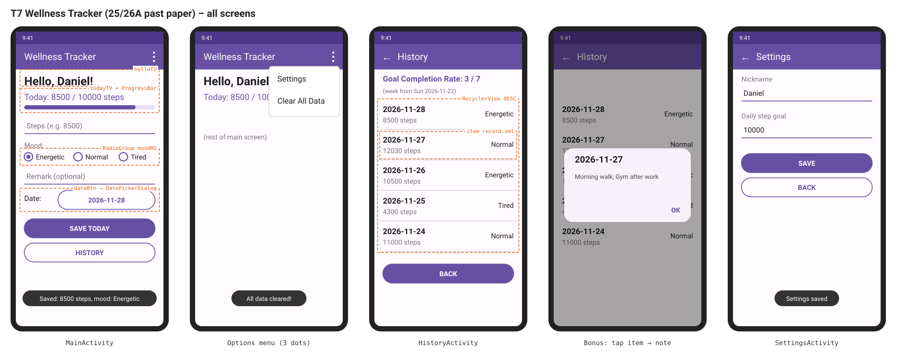

# T7 · Past Paper 25/26A: Wellness Tracker (Full Java Solution + Plan)

[⬅ Index](../README.md) · Related: [08 Room/Prefs](../sheets/08-storage-prefs-files-room.md) · [09 RecyclerView](../sheets/09-recyclerview.md) · [03 Menu/Dialog/Intent](../sheets/03-activity-intent-lifecycle.md)



## 0. What the paper asks (100 marks + 10 bonus)
| Part | Marks | Must have |
|---|---|---|
| 1 Main Activity | 30 | "Hello, {nickname}!" (default **Guest**) · "Today: X / goal steps" (default goal **8000**) · inputs: steps, mood (3 types), remark, **DatePicker** (default today, only **past** dates) · **Save Today**: validate steps > 0; if the date already exists → **add steps, replace mood, append remark** · Toast "Saved: N steps, mood: M" (N = new input) |
| 2 History Activity | 30 | "Goal Completion Rate: x / 7" for **this week, Sunday start** · list from Room **newest first** · each row shows Date / Steps / Mood · Back button · **Bonus 10:** tap a row → Toast/dialog with the remark |
| 3 Data Persistence | 20 | **Room** for records · **SharedPreferences** for `nickname` + `dailyStepGoal` · on start: load prefs + today's record |
| 4 Settings | 20 | **Options menu** → *Settings* (edit nickname + goal, save to prefs, Back button, main screen updates) · *Clear All Data* (delete Room, reset prefs, Toast "All data cleared!") |

## ⏱️ 3-hour plan for this paper
| Time | Do | Build & test |
|---|---|---|
| 0:00–0:10 | New project (Empty Views Activity, Java), add Room deps, Sync | Run empty app |
| 0:10–0:30 | `WellnessRecord`, `RecordDao`, `AppDatabase`, `Prefs`, `DateUtil` | Build |
| 0:30–1:10 | Main layout + MainActivity (hello, today, save with merge) | Save twice on the same date → steps add up |
| 1:10–1:40 | Options menu + SettingsActivity + Clear All | Change goal → main screen updates |
| 1:40–2:20 | HistoryActivity + RecyclerView + week rate | List order, rate |
| 2:20–2:35 | **Bonus**: tap a row → dialog with the note | |
| 2:35–2:55 | Run through the test checklist (bottom of this page) | |
| 2:55–3:00 | Submit | |

> Functionality first, UI second (the paper says so). Get each part **working**, then polish.

---
## Files to create
```
app/src/main/java/com/example/wellness/
├── WellnessRecord.java      (Room entity)
├── RecordDao.java           (Room DAO)
├── AppDatabase.java         (Room DB singleton)
├── Prefs.java               (SharedPreferences keys + defaults)
├── DateUtil.java            (today, format, week range)
├── MainActivity.java
├── HistoryActivity.java
├── RecordAdapter.java
└── SettingsActivity.java
res/layout/  activity_main.xml, activity_history.xml, item_record.xml, activity_settings.xml
res/menu/    main_menu.xml
```
Change `com.example.wellness` to **your** package name in every file.

## build.gradle.kts (Module: app): add inside `dependencies { }`
```kotlin
implementation("androidx.room:room-runtime:2.6.1")
annotationProcessor("androidx.room:room-compiler:2.6.1")
implementation("androidx.recyclerview:recyclerview:1.3.2")
```
Click **Sync Now**.

## AndroidManifest.xml: inside `<application>`
```xml
<activity android:name=".HistoryActivity" android:parentActivityName=".MainActivity" />
<activity android:name=".SettingsActivity" android:parentActivityName=".MainActivity" />
```

---
## 1. Data layer

### WellnessRecord.java
```java
package com.example.wellness;

import androidx.annotation.NonNull;
import androidx.room.Entity;
import androidx.room.PrimaryKey;

@Entity(tableName = "records")
public class WellnessRecord {
    @PrimaryKey
    @NonNull
    public String date;      // "2025-03-15" (one record per date → date is the key)
    public int steps;
    public String mood;
    public String note;

    public WellnessRecord(@NonNull String date, int steps, String mood, String note) {
        this.date = date;
        this.steps = steps;
        this.mood = mood;
        this.note = note;
    }
}
```
> With `date` as the primary key, you can't get two rows for the same day, and `findByDate()` is easy.

### RecordDao.java
```java
package com.example.wellness;

import androidx.room.*;
import java.util.List;

@Dao
public interface RecordDao {
    @Query("SELECT * FROM records WHERE date = :date LIMIT 1")
    WellnessRecord findByDate(String date);

    @Query("SELECT * FROM records ORDER BY date DESC")          // most recent first
    List<WellnessRecord> getAll();

    // yyyy-MM-dd strings sort correctly, so BETWEEN works on dates
    @Query("SELECT COUNT(*) FROM records WHERE date BETWEEN :start AND :end AND steps >= :goal")
    int countGoalReached(String start, String end, int goal);

    @Insert(onConflict = OnConflictStrategy.REPLACE)
    void insert(WellnessRecord r);

    @Update
    void update(WellnessRecord r);

    @Query("DELETE FROM records")
    void deleteAll();
}
```

### AppDatabase.java
```java
package com.example.wellness;

import android.content.Context;
import androidx.room.Database;
import androidx.room.Room;
import androidx.room.RoomDatabase;

@Database(entities = {WellnessRecord.class}, version = 1, exportSchema = false)
public abstract class AppDatabase extends RoomDatabase {
    public abstract RecordDao recordDao();

    private static volatile AppDatabase INSTANCE;

    public static AppDatabase getInstance(Context context) {
        if (INSTANCE == null) {
            synchronized (AppDatabase.class) {
                if (INSTANCE == null) {
                    INSTANCE = Room.databaseBuilder(context.getApplicationContext(),
                                    AppDatabase.class, "wellness_db")
                            .fallbackToDestructiveMigration()
                            .build();
                }
            }
        }
        return INSTANCE;
    }
}
```

### Prefs.java
```java
package com.example.wellness;

import android.content.Context;
import android.content.SharedPreferences;

public class Prefs {
    public static final String FILE = "wellness_prefs";
    public static final String KEY_NICKNAME = "nickname";
    public static final String KEY_GOAL = "dailyStepGoal";
    public static final String DEFAULT_NICKNAME = "Guest";
    public static final int DEFAULT_GOAL = 8000;

    public static SharedPreferences get(Context c) {
        return c.getSharedPreferences(FILE, Context.MODE_PRIVATE);
    }
    public static String nickname(Context c) { return get(c).getString(KEY_NICKNAME, DEFAULT_NICKNAME); }
    public static int goal(Context c)        { return get(c).getInt(KEY_GOAL, DEFAULT_GOAL); }
}
```

### DateUtil.java
```java
package com.example.wellness;

import java.util.Calendar;
import java.util.Locale;

public class DateUtil {
    /** Calendar → "yyyy-MM-dd" */
    public static String format(Calendar c) {
        return String.format(Locale.US, "%04d-%02d-%02d",
                c.get(Calendar.YEAR), c.get(Calendar.MONTH) + 1, c.get(Calendar.DAY_OF_MONTH));
    }

    public static String today() { return format(Calendar.getInstance()); }

    /** Sunday of the current week */
    public static String weekStart() {
        Calendar c = Calendar.getInstance();
        int daysSinceSunday = c.get(Calendar.DAY_OF_WEEK) - Calendar.SUNDAY;  // SUNDAY = 1
        c.add(Calendar.DAY_OF_MONTH, -daysSinceSunday);
        return format(c);
    }

    /** Saturday of the current week */
    public static String weekEnd() {
        Calendar c = Calendar.getInstance();
        int daysSinceSunday = c.get(Calendar.DAY_OF_WEEK) - Calendar.SUNDAY;
        c.add(Calendar.DAY_OF_MONTH, 6 - daysSinceSunday);
        return format(c);
    }
}
```
> `Calendar` works on every API level. (`LocalDate` needs API 26+.) Remember: `Calendar.MONTH` is 0-based, hence `+ 1`.

---
## 2. Main Activity (30 marks)

### res/layout/activity_main.xml
```xml
<?xml version="1.0" encoding="utf-8"?>
<ScrollView xmlns:android="http://schemas.android.com/apk/res/android"
    android:layout_width="match_parent"
    android:layout_height="match_parent">

    <LinearLayout
        android:layout_width="match_parent"
        android:layout_height="wrap_content"
        android:orientation="vertical"
        android:padding="16dp">

        <TextView
            android:id="@+id/helloTV"
            android:layout_width="wrap_content"
            android:layout_height="wrap_content"
            android:text="Hello, Guest!"
            android:textSize="24sp"
            android:textStyle="bold" />

        <TextView
            android:id="@+id/todayTV"
            android:layout_width="wrap_content"
            android:layout_height="wrap_content"
            android:layout_marginTop="8dp"
            android:text="Today: 0 / 8000 steps"
            android:textSize="18sp" />

        <ProgressBar
            android:id="@+id/progressBar"
            style="?android:attr/progressBarStyleHorizontal"
            android:layout_width="match_parent"
            android:layout_height="wrap_content"
            android:layout_marginTop="4dp"
            android:max="100" />

        <EditText
            android:id="@+id/stepsET"
            android:layout_width="match_parent"
            android:layout_height="wrap_content"
            android:layout_marginTop="16dp"
            android:hint="Steps (e.g. 8500)"
            android:inputType="number" />

        <TextView
            android:layout_width="wrap_content"
            android:layout_height="wrap_content"
            android:layout_marginTop="8dp"
            android:text="Mood:" />

        <RadioGroup
            android:id="@+id/moodRG"
            android:layout_width="match_parent"
            android:layout_height="wrap_content"
            android:orientation="horizontal">

            <RadioButton
                android:id="@+id/energeticRB"
                android:layout_width="wrap_content"
                android:layout_height="wrap_content"
                android:checked="true"
                android:text="Energetic" />

            <RadioButton
                android:id="@+id/normalRB"
                android:layout_width="wrap_content"
                android:layout_height="wrap_content"
                android:text="Normal" />

            <RadioButton
                android:id="@+id/tiredRB"
                android:layout_width="wrap_content"
                android:layout_height="wrap_content"
                android:text="Tired" />
        </RadioGroup>

        <EditText
            android:id="@+id/remarkET"
            android:layout_width="match_parent"
            android:layout_height="wrap_content"
            android:hint="Remark (optional)"
            android:inputType="text" />

        <LinearLayout
            android:layout_width="match_parent"
            android:layout_height="wrap_content"
            android:layout_marginTop="8dp"
            android:gravity="center_vertical"
            android:orientation="horizontal">

            <TextView
                android:layout_width="wrap_content"
                android:layout_height="wrap_content"
                android:text="Date:" />

            <Button
                android:id="@+id/dateBtn"
                android:layout_width="0dp"
                android:layout_height="wrap_content"
                android:layout_marginStart="8dp"
                android:layout_weight="1"
                android:text="2025-01-01" />
        </LinearLayout>

        <Button
            android:id="@+id/saveBtn"
            android:layout_width="match_parent"
            android:layout_height="wrap_content"
            android:layout_marginTop="16dp"
            android:text="Save Today" />

        <Button
            android:id="@+id/historyBtn"
            android:layout_width="match_parent"
            android:layout_height="wrap_content"
            android:text="History" />
    </LinearLayout>
</ScrollView>
```
> The paper spells the mood "*Energic*". Using **Energetic** (correct spelling) is fine, as long as there are 3 moods.

### res/menu/main_menu.xml
```xml
<?xml version="1.0" encoding="utf-8"?>
<menu xmlns:android="http://schemas.android.com/apk/res/android">
    <item android:id="@+id/action_settings" android:title="Settings" />
    <item android:id="@+id/action_clear" android:title="Clear All Data" />
</menu>
```

### MainActivity.java
```java
package com.example.wellness;

import android.app.DatePickerDialog;
import android.content.Intent;
import android.os.Bundle;
import android.os.Handler;
import android.os.Looper;
import android.view.Menu;
import android.view.MenuItem;
import android.widget.*;
import androidx.annotation.NonNull;
import androidx.appcompat.app.AlertDialog;
import androidx.appcompat.app.AppCompatActivity;
import java.util.Calendar;
import java.util.concurrent.ExecutorService;
import java.util.concurrent.Executors;

public class MainActivity extends AppCompatActivity {

    private TextView helloTV, todayTV;
    private ProgressBar progressBar;
    private EditText stepsET, remarkET;
    private RadioGroup moodRG;
    private Button dateBtn;

    private String selectedDate;                      // "yyyy-MM-dd"
    private RecordDao dao;
    private final ExecutorService io = Executors.newSingleThreadExecutor();
    private final Handler main = new Handler(Looper.getMainLooper());

    @Override
    protected void onCreate(Bundle savedInstanceState) {
        super.onCreate(savedInstanceState);
        setContentView(R.layout.activity_main);

        helloTV = findViewById(R.id.helloTV);
        todayTV = findViewById(R.id.todayTV);
        progressBar = findViewById(R.id.progressBar);
        stepsET = findViewById(R.id.stepsET);
        remarkET = findViewById(R.id.remarkET);
        moodRG = findViewById(R.id.moodRG);
        dateBtn = findViewById(R.id.dateBtn);

        dao = AppDatabase.getInstance(this).recordDao();

        // Date picker: today by default
        selectedDate = DateUtil.today();
        if (savedInstanceState != null) selectedDate = savedInstanceState.getString("DATE", selectedDate);
        dateBtn.setText(selectedDate);
        dateBtn.setOnClickListener(v -> showDatePicker());

        findViewById(R.id.saveBtn).setOnClickListener(v -> saveRecord());
        findViewById(R.id.historyBtn).setOnClickListener(v ->
                startActivity(new Intent(this, HistoryActivity.class)));
    }

    /** Runs on start AND every time we come back (e.g. from Settings) → always up to date */
    @Override
    protected void onResume() {
        super.onResume();
        refreshHeader();
    }

    private void refreshHeader() {
        String nickname = Prefs.nickname(this);
        int goal = Prefs.goal(this);
        helloTV.setText("Hello, " + nickname + "!");

        io.execute(() -> {
            WellnessRecord today = dao.findByDate(DateUtil.today());
            int steps = (today == null) ? 0 : today.steps;
            main.post(() -> {
                todayTV.setText("Today: " + steps + " / " + goal + " steps");
                progressBar.setProgress(Math.min(100, steps * 100 / goal));
            });
        });
    }

    private void showDatePicker() {
        Calendar c = Calendar.getInstance();
        // pre-select the currently chosen date
        String[] p = selectedDate.split("-");
        c.set(Integer.parseInt(p[0]), Integer.parseInt(p[1]) - 1, Integer.parseInt(p[2]));

        DatePickerDialog dlg = new DatePickerDialog(this, (view, year, month, day) -> {
            Calendar picked = Calendar.getInstance();
            picked.set(year, month, day);
            selectedDate = DateUtil.format(picked);
            dateBtn.setText(selectedDate);
        }, c.get(Calendar.YEAR), c.get(Calendar.MONTH), c.get(Calendar.DAY_OF_MONTH));

        dlg.getDatePicker().setMaxDate(System.currentTimeMillis());   // only today or PREVIOUS dates
        dlg.show();
    }

    private String selectedMood() {
        int id = moodRG.getCheckedRadioButtonId();
        if (id == R.id.normalRB) return "Normal";
        if (id == R.id.tiredRB) return "Tired";
        return "Energetic";
    }

    private void saveRecord() {
        // ---- validate ----
        String s = stepsET.getText().toString().trim();
        if (s.isEmpty()) { stepsET.setError("Please enter steps"); return; }
        int steps;
        try {
            steps = Integer.parseInt(s);
        } catch (NumberFormatException e) {
            stepsET.setError("Invalid number"); return;
        }
        if (steps <= 0) { stepsET.setError("Steps must be > 0"); return; }

        String mood = selectedMood();
        String remark = remarkET.getText().toString().trim();
        String date = selectedDate;

        // ---- save / merge in Room (background thread) ----
        io.execute(() -> {
            WellnessRecord old = dao.findByDate(date);
            if (old == null) {
                dao.insert(new WellnessRecord(date, steps, mood, remark));
            } else {
                old.steps = old.steps + steps;                 // add steps
                old.mood = mood;                               // replace mood
                if (!remark.isEmpty()) {                       // append remark
                    old.note = (old.note == null || old.note.isEmpty())
                            ? remark : old.note + "; " + remark;
                }
                dao.update(old);
            }
            main.post(() -> {
                Toast.makeText(this, "Saved: " + steps + " steps, mood: " + mood,
                        Toast.LENGTH_SHORT).show();
                stepsET.setText("");
                remarkET.setText("");
                refreshHeader();
            });
        });
    }

    // ---- Options menu ----
    @Override
    public boolean onCreateOptionsMenu(Menu menu) {
        getMenuInflater().inflate(R.menu.main_menu, menu);
        return true;
    }

    @Override
    public boolean onOptionsItemSelected(@NonNull MenuItem item) {
        int id = item.getItemId();
        if (id == R.id.action_settings) {
            startActivity(new Intent(this, SettingsActivity.class));
            return true;
        } else if (id == R.id.action_clear) {
            confirmClearAll();
            return true;
        }
        return super.onOptionsItemSelected(item);
    }

    private void confirmClearAll() {
        new AlertDialog.Builder(this)
                .setTitle("Clear All Data?")
                .setMessage("All records and settings will be deleted.")
                .setPositiveButton("Clear", (d, w) -> clearAll())
                .setNegativeButton("Cancel", null)
                .show();
    }

    private void clearAll() {
        Prefs.get(this).edit().clear().apply();          // reset prefs to default
        io.execute(() -> {
            dao.deleteAll();                              // delete all Room records
            main.post(() -> {
                Toast.makeText(this, "All data cleared!", Toast.LENGTH_SHORT).show();
                refreshHeader();
            });
        });
    }

    @Override
    protected void onSaveInstanceState(@NonNull Bundle out) {
        super.onSaveInstanceState(out);
        out.putString("DATE", selectedDate);              // keep picked date on rotation
    }

    @Override
    protected void onDestroy() {
        super.onDestroy();
        io.shutdown();
    }
}
```
> If your theme is `...NoActionBar`, the ⋮ menu won't show. Check `res/values/themes.xml` and use a parent **without** `NoActionBar` (e.g. `Theme.Material3.DayNight` or `Theme.AppCompat.Light.DarkActionBar`).

---
## 3. History Activity (30 + 10 bonus)

### res/layout/activity_history.xml
```xml
<?xml version="1.0" encoding="utf-8"?>
<LinearLayout xmlns:android="http://schemas.android.com/apk/res/android"
    android:layout_width="match_parent"
    android:layout_height="match_parent"
    android:orientation="vertical"
    android:padding="16dp">

    <TextView
        android:id="@+id/rateTV"
        android:layout_width="wrap_content"
        android:layout_height="wrap_content"
        android:text="Goal Completion Rate: 0 / 7"
        android:textSize="18sp"
        android:textStyle="bold" />

    <TextView
        android:id="@+id/weekTV"
        android:layout_width="wrap_content"
        android:layout_height="wrap_content"
        android:textSize="12sp" />

    <TextView
        android:id="@+id/emptyTV"
        android:layout_width="wrap_content"
        android:layout_height="wrap_content"
        android:layout_marginTop="16dp"
        android:text="No records yet"
        android:visibility="gone" />

    <androidx.recyclerview.widget.RecyclerView
        android:id="@+id/recordRV"
        android:layout_width="match_parent"
        android:layout_height="0dp"
        android:layout_marginTop="8dp"
        android:layout_weight="1" />

    <Button
        android:id="@+id/backBtn"
        android:layout_width="match_parent"
        android:layout_height="wrap_content"
        android:text="Back" />
</LinearLayout>
```

### res/layout/item_record.xml
```xml
<?xml version="1.0" encoding="utf-8"?>
<LinearLayout xmlns:android="http://schemas.android.com/apk/res/android"
    android:layout_width="match_parent"
    android:layout_height="wrap_content"
    android:gravity="center_vertical"
    android:orientation="horizontal"
    android:padding="12dp">

    <LinearLayout
        android:layout_width="0dp"
        android:layout_height="wrap_content"
        android:layout_weight="1"
        android:orientation="vertical">

        <TextView
            android:id="@+id/dateTV"
            android:layout_width="wrap_content"
            android:layout_height="wrap_content"
            android:textSize="16sp"
            android:textStyle="bold" />

        <TextView
            android:id="@+id/stepsTV"
            android:layout_width="wrap_content"
            android:layout_height="wrap_content" />
    </LinearLayout>

    <TextView
        android:id="@+id/moodTV"
        android:layout_width="wrap_content"
        android:layout_height="wrap_content"
        android:textSize="16sp" />
</LinearLayout>
```

### RecordAdapter.java
```java
package com.example.wellness;

import android.view.LayoutInflater;
import android.view.View;
import android.view.ViewGroup;
import android.widget.TextView;
import androidx.annotation.NonNull;
import androidx.recyclerview.widget.RecyclerView;
import java.util.ArrayList;
import java.util.List;

public class RecordAdapter extends RecyclerView.Adapter<RecordAdapter.VH> {

    public interface OnItemClick { void onClick(WellnessRecord r); }

    private final List<WellnessRecord> data = new ArrayList<>();
    private final OnItemClick listener;

    public RecordAdapter(OnItemClick listener) { this.listener = listener; }

    public void setData(List<WellnessRecord> list) {
        data.clear();
        data.addAll(list);
        notifyDataSetChanged();
    }

    static class VH extends RecyclerView.ViewHolder {
        TextView dateTV, stepsTV, moodTV;
        VH(@NonNull View v) {
            super(v);
            dateTV = v.findViewById(R.id.dateTV);
            stepsTV = v.findViewById(R.id.stepsTV);
            moodTV = v.findViewById(R.id.moodTV);
        }
    }

    @NonNull @Override
    public VH onCreateViewHolder(@NonNull ViewGroup parent, int viewType) {
        View v = LayoutInflater.from(parent.getContext()).inflate(R.layout.item_record, parent, false);
        return new VH(v);
    }

    @Override
    public void onBindViewHolder(@NonNull VH h, int position) {
        WellnessRecord r = data.get(position);
        h.dateTV.setText(r.date);
        h.stepsTV.setText(r.steps + " steps");
        h.moodTV.setText(moodIcon(r.mood) + " " + r.mood);
        h.itemView.setOnClickListener(v -> listener.onClick(r));     // bonus
    }

    @Override public int getItemCount() { return data.size(); }

    private static String moodIcon(String mood) {                       // "small icon"
        if ("Energetic".equals(mood)) return "😄";
        if ("Tired".equals(mood)) return "😴";
        return "🙂";
    }
}
```

### HistoryActivity.java
```java
package com.example.wellness;

import android.os.Bundle;
import android.os.Handler;
import android.os.Looper;
import android.view.View;
import android.widget.TextView;
import androidx.appcompat.app.AlertDialog;
import androidx.appcompat.app.AppCompatActivity;
import androidx.recyclerview.widget.DividerItemDecoration;
import androidx.recyclerview.widget.LinearLayoutManager;
import androidx.recyclerview.widget.RecyclerView;
import java.util.List;
import java.util.concurrent.ExecutorService;
import java.util.concurrent.Executors;

public class HistoryActivity extends AppCompatActivity {

    private RecordAdapter adapter;
    private TextView rateTV, weekTV, emptyTV;
    private RecordDao dao;
    private final ExecutorService io = Executors.newSingleThreadExecutor();
    private final Handler main = new Handler(Looper.getMainLooper());

    @Override
    protected void onCreate(Bundle savedInstanceState) {
        super.onCreate(savedInstanceState);
        setContentView(R.layout.activity_history);
        if (getSupportActionBar() != null) {
            getSupportActionBar().setTitle("History");
            getSupportActionBar().setDisplayHomeAsUpEnabled(true);
        }

        rateTV = findViewById(R.id.rateTV);
        weekTV = findViewById(R.id.weekTV);
        emptyTV = findViewById(R.id.emptyTV);
        dao = AppDatabase.getInstance(this).recordDao();

        RecyclerView rv = findViewById(R.id.recordRV);
        rv.setLayoutManager(new LinearLayoutManager(this));
        rv.addItemDecoration(new DividerItemDecoration(this, DividerItemDecoration.VERTICAL));
        adapter = new RecordAdapter(this::showNote);                 // bonus click
        rv.setAdapter(adapter);

        findViewById(R.id.backBtn).setOnClickListener(v -> finish());   // back to Main

        loadData();
    }

    private void loadData() {
        int goal = Prefs.goal(this);
        String start = DateUtil.weekStart();
        String end = DateUtil.weekEnd();

        io.execute(() -> {
            List<WellnessRecord> list = dao.getAll();                       // date DESC
            int reached = dao.countGoalReached(start, end, goal);
            main.post(() -> {
                adapter.setData(list);
                emptyTV.setVisibility(list.isEmpty() ? View.VISIBLE : View.GONE);
                rateTV.setText("Goal Completion Rate: " + reached + " / 7");
                weekTV.setText("Week: " + start + " (Sun) to " + end + " (Sat) · goal " + goal);
            });
        });
    }

    /** Bonus: tap item → dialog with the remark */
    private void showNote(WellnessRecord r) {
        String note = (r.note == null || r.note.isEmpty()) ? "No remark for this day." : r.note;
        new AlertDialog.Builder(this)
                .setTitle(r.date)
                .setMessage(note)
                .setPositiveButton("OK", null)
                .show();
    }

    @Override
    public boolean onSupportNavigateUp() { finish(); return true; }

    @Override
    protected void onDestroy() { super.onDestroy(); io.shutdown(); }
}
```

---
## 4. Settings (20 marks)

### res/layout/activity_settings.xml
```xml
<?xml version="1.0" encoding="utf-8"?>
<LinearLayout xmlns:android="http://schemas.android.com/apk/res/android"
    android:layout_width="match_parent"
    android:layout_height="match_parent"
    android:orientation="vertical"
    android:padding="16dp">

    <TextView
        android:layout_width="wrap_content"
        android:layout_height="wrap_content"
        android:text="Nickname" />

    <EditText
        android:id="@+id/nicknameET"
        android:layout_width="match_parent"
        android:layout_height="wrap_content"
        android:hint="Guest"
        android:inputType="textPersonName" />

    <TextView
        android:layout_width="wrap_content"
        android:layout_height="wrap_content"
        android:layout_marginTop="16dp"
        android:text="Daily step goal" />

    <EditText
        android:id="@+id/goalET"
        android:layout_width="match_parent"
        android:layout_height="wrap_content"
        android:hint="8000"
        android:inputType="number" />

    <Button
        android:id="@+id/saveSettingsBtn"
        android:layout_width="match_parent"
        android:layout_height="wrap_content"
        android:layout_marginTop="24dp"
        android:text="Save" />

    <Button
        android:id="@+id/backBtn"
        android:layout_width="match_parent"
        android:layout_height="wrap_content"
        android:text="Back" />
</LinearLayout>
```

### SettingsActivity.java
```java
package com.example.wellness;

import android.os.Bundle;
import android.widget.EditText;
import android.widget.Toast;
import androidx.appcompat.app.AppCompatActivity;

public class SettingsActivity extends AppCompatActivity {

    private EditText nicknameET, goalET;

    @Override
    protected void onCreate(Bundle savedInstanceState) {
        super.onCreate(savedInstanceState);
        setContentView(R.layout.activity_settings);
        if (getSupportActionBar() != null) {
            getSupportActionBar().setTitle("Settings");
            getSupportActionBar().setDisplayHomeAsUpEnabled(true);
        }

        nicknameET = findViewById(R.id.nicknameET);
        goalET = findViewById(R.id.goalET);

        // pre-fill current values
        nicknameET.setText(Prefs.nickname(this));
        goalET.setText(String.valueOf(Prefs.goal(this)));

        findViewById(R.id.saveSettingsBtn).setOnClickListener(v -> save());
        findViewById(R.id.backBtn).setOnClickListener(v -> finish());
    }

    private void save() {
        String nickname = nicknameET.getText().toString().trim();
        String g = goalET.getText().toString().trim();

        int goal;
        try {
            goal = Integer.parseInt(g);
        } catch (NumberFormatException e) {
            goalET.setError("Enter a number"); return;
        }
        if (goal <= 0) { goalET.setError("Goal must be > 0"); return; }
        if (nickname.isEmpty()) nickname = Prefs.DEFAULT_NICKNAME;

        Prefs.get(this).edit()
                .putString(Prefs.KEY_NICKNAME, nickname)
                .putInt(Prefs.KEY_GOAL, goal)
                .apply();

        Toast.makeText(this, "Settings saved", Toast.LENGTH_SHORT).show();
        finish();          // MainActivity.onResume() refreshes the header
    }

    @Override
    public boolean onSupportNavigateUp() { finish(); return true; }
}
```

---
## ✅ Test checklist (do this before submitting)
| # | Test | Expected |
|---|---|---|
| 1 | Fresh install | "Hello, Guest!" · "Today: 0 / 8000 steps" |
| 2 | Save with empty steps / 0 / -5 / `abc` | error shown, no crash, nothing saved |
| 3 | Save 3000, Normal, remark "walk" | Toast "Saved: 3000 steps, mood: Normal"; Today 3000 / 8000 |
| 4 | Save again 2000, Tired, remark "gym" (same date) | Toast says **2000**; Today **5000**; History row mood **Tired**; tapping it shows **"walk; gym"** |
| 5 | Date picker | can't pick tomorrow; pick yesterday + save → History shows a new row; Today unchanged |
| 6 | History order | newest date on top |
| 7 | Week rate | days this week (Sun–Sat) with steps ≥ goal, out of 7 |
| 8 | Settings → nickname "Ann", goal 5000 → Save | main shows "Hello, Ann!" + "/ 5000" |
| 9 | Menu → Clear All Data | Toast "All data cleared!"; Guest / 8000 / 0; History empty |
| 10 | Close the app completely and reopen | data still there (Room + prefs) |
| 11 | Rotate on Main | no crash; selected date kept |

## ⚡ If short of time (priority order)
1. Room entity/DAO/DB + **Save with merge** + Toast → biggest marks.
2. Hello + Today text with prefs defaults.
3. History list (DESC) + Back button.
4. Options menu + Settings + Clear All.
5. Week completion rate.
6. Bonus dialog (only ~5 lines, so do it if time remains).
7. Last resort: `.allowMainThreadQueries()` on the Room builder lets you call `dao` directly without the Executor. Add a comment saying it's for simplicity.

## 🔮 Likely variations this year (same skeleton)
| If they ask… | Change |
|---|---|
| Different domain (water intake, expenses, study hours, habit tracker…) | rename the entity fields; the logic is the same |
| Spinner instead of RadioGroup | [sheet 02 Spinner](../sheets/02-layouts-widgets.md#spinner-dropdown) · `spinner.getSelectedItem().toString()` |
| Delete one record | long-press row → confirm dialog → `@Delete void delete(WellnessRecord r)` then reload |
| Edit a record | tap row → dialog with EditText → `dao.update(r)` (see [T2](T2-room-recyclerview-crud.md)) |
| Weekly/monthly total or average | `@Query("SELECT SUM(steps) FROM records WHERE date BETWEEN :s AND :e") int sum(String s, String e);` (`AVG(steps)` for the average) |
| Monday as week start | `int daysSinceMonday = (c.get(Calendar.DAY_OF_WEEK) + 5) % 7;` |
| Filter list by mood | `@Query("SELECT * FROM records WHERE mood = :m ORDER BY date DESC")` |
| Use MVVM / ViewModel + LiveData | DAO returns `LiveData<List<WellnessRecord>>`; see [sheet 05](../sheets/05-architecture-mvvm.md) "MVVM + Room" |
| Fragments instead of Activities | [sheet 04](../sheets/04-fragments.md) |
| Show the goal-reached rows in green | in `onBindViewHolder`: `h.stepsTV.setTextColor(r.steps >= goal ? Color.GREEN : Color.BLACK)` (pass `goal` to the adapter) |
| Landscape layout | [sheet 14 recipes](../sheets/14-screen-gallery.md#12-layout-change-recipes) |
